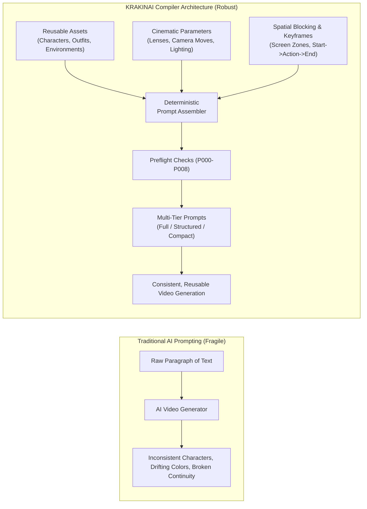
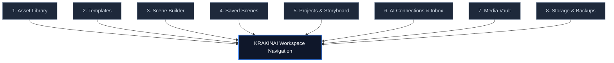
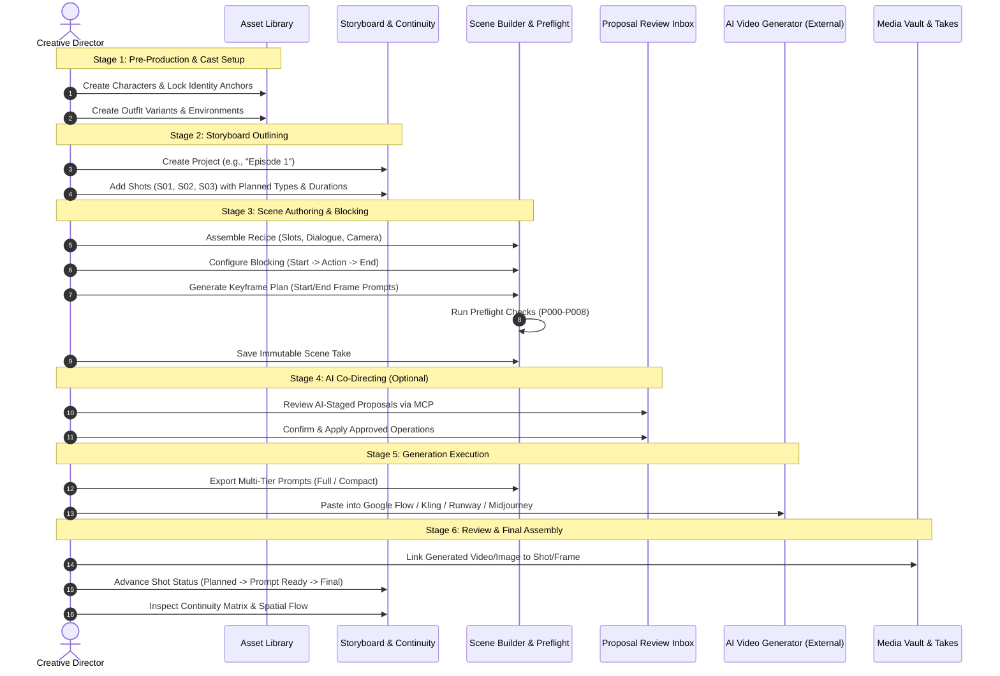

# Chapter 1: Introduction & Core Mental Model

> *Part I: Foundations & Mental Model*  
> Previous: [README (Cover & Table of Contents)](./README.md) | Next: [Chapter 2: Complete Terminology & Glossary](./02-terminologies-and-glossary.md)

---

## 1. The Paradigm Shift: Why KRAKINAI Exists

Traditional AI image and video generation tools suffer from a fundamental flaw: **they treat complex visual storytelling as disposable, one-off text blobs**. When directing a multi-shot sequence or an episodic narrative, creators face massive friction:
- **Character Drift**: A character's facial features, age, clothing, or hair change unpredictably between Shot 1 and Shot 2.
- **Lost Cinematic Intent**: Camera movements, lens selections, and lighting styles get buried in massive "prompt soup," resulting in AI hallucinations and conflicting directions.
- **Zero Reusability**: When a scene prompt works, changing one character's wardrobe or tweaking a camera angle requires manually rewriting dozens of sentences across multiple documents.
- **Uncontrolled AI Overwrites**: Autonomous AI tools often hallucinate non-existent files or overwrite previously working scripts with unverified changes.

**KRAKINAI solves this by introducing a local-first, compiler-driven mental model for visual storytelling.** In KRAKINAI, a prompt is not a raw paragraph typed into a chat box; it is an **assembled software artifact** compiled deterministically from modular, reusable assets and structured cinematic parameters.

---

## 2. The Four Core Architectural Pillars

Every feature in KRAKINAI is built upon four foundational principles:

### Pillar 1: Recipe over Raw Text
Instead of unstructured text, scenes are authored as **Recipes** consisting of discrete **Builder Slots**:
- Character & Identity Anchors
- Wardrobe / Outfits
- Environment / Location
- Physical Actions
- Camera Angle, Lens & Movement
- Lighting Mood & Time of Day
- Visual Style & Medium

By separating these components, changing a character's wardrobe across an entire episodic storyline requires selecting a new **Outfit variant**, without touching the character's facial features, the environment, or the cinematography instructions.

### Pillar 2: Immutable Scene History
In film production, you never erase a previous camera take; you shoot Take 2 while preserving Take 1. KRAKINAI enforces **strict immutability**:
- When a saved scene recipe is modified, KRAKINAI **never overwrites** the existing record in storage.
- It produces a new revision with an incremented version number, linking back to the original `headId` and preserving the complete parent revision lineage.
- Multiple takes on the same shot can be saved, tested, compared, and swapped without ever losing working prompt outputs.

### Pillar 3: Deterministic Assembly & Preflight
KRAKINAI behaves like a compiler:
- Given the exact same assets, slots, dialogue, and camera settings, the **Prompt Assembler** always outputs the exact same character-for-character prompt.
- Negative prompts and "avoid" text inherit deterministically from parent assets down to individual shots.
- Before a scene can be saved or submitted, the **Preflight Engine** evaluates deterministic rules (`P000` through `P008`), catching common visual contradictions (e.g., commanding a camera to be stationary while simultaneously commanding a dolly push-in, or requesting a direct lens gaze while placing the camera behind the character).

### Pillar 4: Human-Governed AI Pair Directing
AI assistants (like Claude, Codex, Antigravity, or local LLMs) can act as brilliant co-directors, but they must never act as unchecked administrators:
- MCP tools and Stage B imports submit structured **proposals** into the browser's **Proposal Review Inbox**.
- **No external AI tool can write directly to your local database.**
- Every staged proposal displays visual diffs, allows selective operation approvals, and requires an explicit, authenticated human click (`event.isTrusted`) to apply.

---

## 3. The Workspace Navigation Map

KRAKINAI is structured into **8 primary workspace views**, accessible via the global navigation sidebar:

1. **Asset Library**: The creative repository of reusable visual elements. Create and manage Characters (with locked Identity Anchors), Outfits, Environments, Actions, Camera profiles, Lighting setups, and Visual Styles.
2. **Templates**: Pre-configured scene baselines with pre-selected slots, default camera movements, and negative constraints for rapid shot authoring.
3. **Scene Builder**: The heart of KRAKINAI. An interactive canvas for assembling recipes, organizing Multi-Character Ensembles, timing Dialogue Cues, setting Cinematography parameters, authoring Shot Blocking (v5), and planning Keyframes (v6).
4. **Saved Scenes**: The immutable catalog of saved scene takes. Inspect prompt outputs, compare revision diffs, soft-archive deprecated takes, perform bulk operations, and export compiled prompts.
5. **Projects & Storyboard**: The episodic director suite. Organize shots into sequential storyboards, assign shot codes and planned durations, attach and switch preferred takes, inspect the **Cast Bible Continuity Matrix**, and review **Spatial Blocking Continuity**.
6. **AI Connections & Proposals**: Manage local AI bridge pairings, configure granular disclosure scopes (`McpScope`), inspect incoming AI proposals, review operation diffs, and approve or reject change-sets.
7. **Media Vault**: Local reference files, visual identity anchors, and externally generated video/image assets linked to specific shots and keyframes.
8. **Storage & Backups**: Local storage health diagnostics, backup exports (JSON/ZIP), storage quota usage, and database maintenance tools.

---

## 4. The End-to-End Production Lifecycle

Directing a project in KRAKINAI follows a clean 6-stage lifecycle:

### Stage 1: Pre-Production & Library Setup
Before writing individual scenes, you define your narrative's reusable visual cast. Characters receive **Identity Anchors** that freeze critical facial structure, ethnicity, and distinguishing marks. Reusable environments and styles are created once and referenced across all scenes.

### Stage 2: Project & Storyboard Outlining
Create a Project (e.g., a commercial, a pilot episode, or a cinematic trailer). Outline your storyboard shots with code designations (e.g., `S01`, `S02`), planned durations, and intended shot types.

### Stage 3: Modular Scene Authoring
In the Scene Builder, author modular takes for each shot. Select a **Context-Aware Shot Type** (`character_scene`, `property_environment`, `graphic_motion`, `existing_footage`). Bind assets into slots, configure multi-character ensemble roles, set timed dialogue cues, fine-tune lens and movement parameters in the Cinematography Studio, and define spatial staging in Shot Blocking.

### Stage 4: Deterministic Preflight & Validation
As you author, KRAKINAI's Preflight engine evaluates the scene against semantic rules (`P000`–`P008`), catching potential visual conflicts before you burn generation tokens.

### Stage 5: External Generation
KRAKINAI compiles the recipe into exact, model-optimized prompts. Export Full Prompts for detailed image generation (Midjourney, Flux, Stable Diffusion) or Compact Prompts with start/end keyframe descriptions for state-of-the-art video models (Google Flow, Kling, Runway Gen-3, Luma Dream Machine).

### Stage 6: Media Association & Continuity Finalization
Import generated video clips or keyframe images back into KRAKINAI's Media Vault, linking them to specific shots. Track the production status of each shot from `planned` to `final` and verify that character presence, clothing, and spatial positions remain continuous across every cut.

---

> **Next Up:** Continue to [Chapter 2: Complete Terminology & Glossary](./02-terminologies-and-glossary.md) to explore every entity, property, and concept in the KRAKINAI ecosystem.
