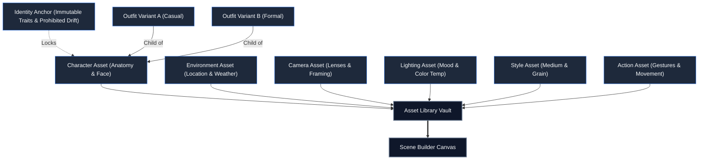
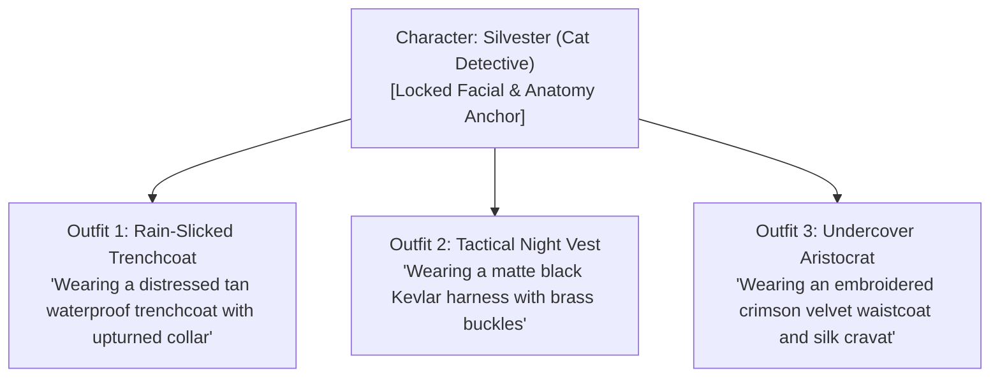

# Chapter 3: Building Your Reusable Asset Library & Templates

> *Part II: How to Use KRAKINAI (User & Director Guide)*  
> Previous: [Chapter 2: Complete Terminology & Glossary](./02-terminologies-and-glossary.md) | Next: [Chapter 4: Authoring Scenes — Recipe Builder, Ensemble, Camera & Preflight](./04-user-guide-scene-authoring.md)

---

## 1. Overview: The Library as the Production Foundation

In traditional video production, a studio maintains physical wardrobe departments, set warehouses, and character casting sheets before shooting begins. KRAKINAI mirrors this professional methodology: **the Asset Library is your persistent pre-production vault**.

By defining your characters, environments, wardrobe items, camera packages, and visual styles up front, you build an interconnected repository that powers:
1. **Zero-Drift Continuity**: Reusing the exact same character asset across 50 shots ensures facial structure and key anatomical traits never morph.
2. **Rapid Scene Composition**: Instead of re-typing location descriptions or lighting recipes, you pull them directly from your library into the Scene Builder with a single click.
3. **Episodic Wardrobe Tracking**: Outfits linked to characters allow instant costume changes across shots while maintaining character identity.

---

## 2. Navigating the Asset Library

To access your assets, click **Library** in the left-hand navigation sidebar. The library interface provides:
- **Category Filter Tabs**: Quickly isolate items by category: `All`, `Characters`, `Wardrobe`, `Environments`, `Actions`, `Camera`, `Lighting`, or `Styles`.
- **Search & Tag Filtering**: Real-time keyword filtering matching asset titles, tags, and description text.
- **Favorites Quick-Filter**: Toggle the star icon to surface your most frequently used production assets.
- **Revision Counters**: Every asset badge displays its current revision number (e.g., `Rev 3`), indicating how many times it has been updated while preserving backward compatibility.

---

## 3. Creating and Authoring Prompt Assets

To create a new asset:
1. Click **New Asset** in the top-right corner of the Library.
2. Fill out the standard asset properties:
   - **Title**: A clear, human-readable name (e.g., *"Detective Sarah Vance"*, *"Rain-Slicked Neon Alleyway"*, *"35mm Anamorphic Lens Profile"*).
   - **Category**: Select one of the 7 core categories (`characters`, `wardrobe`, `environments`, `actions`, `camera`, `lighting`, `styles`).
   - **Prompt Text**: The full, detailed descriptive text that will be injected into assembled scene prompts. Write with sensory clarity and specific physical details.
   - **Compact Text (Optional)**: A condensed 1–2 sentence shorthand. Used when generating compact prompts or running fast exploratory storyboard previews.
   - **Tags**: Comma-separated labels (e.g., `protagonist, cyberpunk, detective, noir`) for rapid search and AI grouping.
   - **Director Notes**: Private production notes, voice actor references, or backstory notes. These notes are excluded from generated prompts unless specifically granted to AI assistants via MCP permissions.
3. Click **Save Asset**.

---

## 4. Locking Character Identity Anchors

### Why Identity Anchors Are Vital
Generative AI diffusion models have a notorious tendency to alter character faces, eye colors, age, and hair whenever the scene prompt changes clothing or environment. KRAKINAI's **Identity Anchor** system creates a strict cryptographic boundary around character anatomy.

### How to Configure an Identity Anchor
1. Open any **Character** asset from the Library.
2. Scroll to the **Identity Anchor** card.
3. Configure the three identity fields:
   - **Approved Identity Text**: The exact prompt text that describes the character's facial structure, hair color, eye shape, age, and complexion.
   - **Immutable Traits**: Specific, bullet-pointed non-negotiable features. For example:
     - *Piercing amber eyes with distinct hooded lids*
     - *Faint diagonal scar across the left eyebrow*
     - *Sharp high cheekbones and pointed chin*
     - *Naturally tousled raven-black wavy hair*
   - **Prohibited Drift**: Explicit negative directives telling both human authors and AI agents what must *never* change:
     - *Never add facial hair or stubble*
     - *Do not alter eye color from amber*
     - *Do not change apparent age (must remain mid-30s)*
4. Click **Review & Approve Anchor**.
5. Once approved:
   - The status switches from `draft` to **`approved`**.
   - The anchor captures the `approvedMasterIdentityRevision`.
   - When authoring scenes in Ensemble or Recipe mode, you can select whether to pull the master description or the locked anchor.

> [!IMPORTANT]
> External AI agents connected over MCP are strictly prohibited from modifying approved Identity Anchors unless explicit Character Identity disclosure grants are active. Staged change-sets cannot silently tamper with an approved identity anchor.

---

## 5. Authoring Character-Owned Outfit Variants

In film, characters change costumes between days, environments, and story beats. In KRAKINAI, clothing should not be baked into the character's core anatomical prompt. Instead, create **Outfit Variants**:

### Steps to Create an Outfit Variant
1. Open the target Character asset in the Library.
2. In the right-hand sidebar or sub-navigation, click **Add Outfit Variant**.
3. Notice that `parentCharacterId` is automatically linked to the character.
4. Supply the variant details:
   - **Title**: (e.g., *"Classic Tan Trenchcoat"*)
   - **Prompt Text**: (e.g., *"Wearing a heavy, water-repellent tan double-breasted trenchcoat with an upturned storm collar and tarnished brass buttons."*)
   - **Compact Text**: (e.g., *"Tan double-breasted trenchcoat with upturned collar."*)
   - **Tags**: (e.g., `exterior, rain, formal, investigation`)
5. Click **Save Variant**.

### Continuity Benefits of Outfits
When you build scenes with this character, selecting the character automatically surfaces all of their authored Outfit variants. In the **Continuity Workspace**, KRAKINAI monitors whether the character's outfit matches across chronological shots, warning you if an unexpected costume jump occurs between cuts.

---

## 6. Attaching Media References & Samples

Assets can reference local image and video files in the **Media Vault**:

### Two Distinct Media Roles
1. **`reference`**:
   - Visual inspiration, character face model references, color palettes, or set drawings.
   - Can be flagged for inclusion in Stage A AI context exports or prompt assembly.
2. **`sample`**:
   - Actual test generations produced by external tools (Midjourney, Runway, Kling).
   - Stored alongside the asset to verify whether the prompt text yields the expected aesthetic.

### Linking Media
Inside any asset editor, scroll to the **Media Links** section. You can:
- Drag and drop image files directly from your desktop.
- Select existing media from your Media Vault.
- Assign an alt text description and order index.

---

## 7. Scene Templates: Reusable Production Baselines

Templates allow directors to encapsulate recurring shot structures, lighting packages, and style rules into one-click starters.

### What a Template Stores
- Default bindings for any of the 7 slots (e.g., a pre-selected Camera profile, Studio Lighting setup, and 35mm Film Grain style).
- Default Aspect Ratio (e.g., `16:9`, `9:16`, `1:1`) and Duration (e.g., `8s`).
- Inherited Avoid/Negative constraints (e.g., *"avoid lens flares, modern logos, text watermark"*).
- Pre-populated scene instructions.

### Creating and Applying Templates
- **Creating a Template**: Navigate to **Templates** in the main sidebar and click **New Template**. Configure your default slots and settings, then save.
- **Saving from a Working Scene**: In the Scene Builder, open the action dropdown and select **Save as Template**. This copies the active slot configuration into a new template.
- **Applying in the Builder**: When authoring a new scene in the Scene Builder, click **Load Template** to instantly apply the boilerplate settings.

---

> **Next Up:** Continue to [Chapter 4: Authoring Scenes — Recipe Builder, Ensemble, Camera & Preflight](./04-user-guide-scene-authoring.md) to discover how to assemble your assets into modular, validated video prompts.
