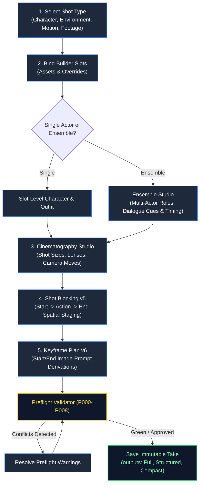
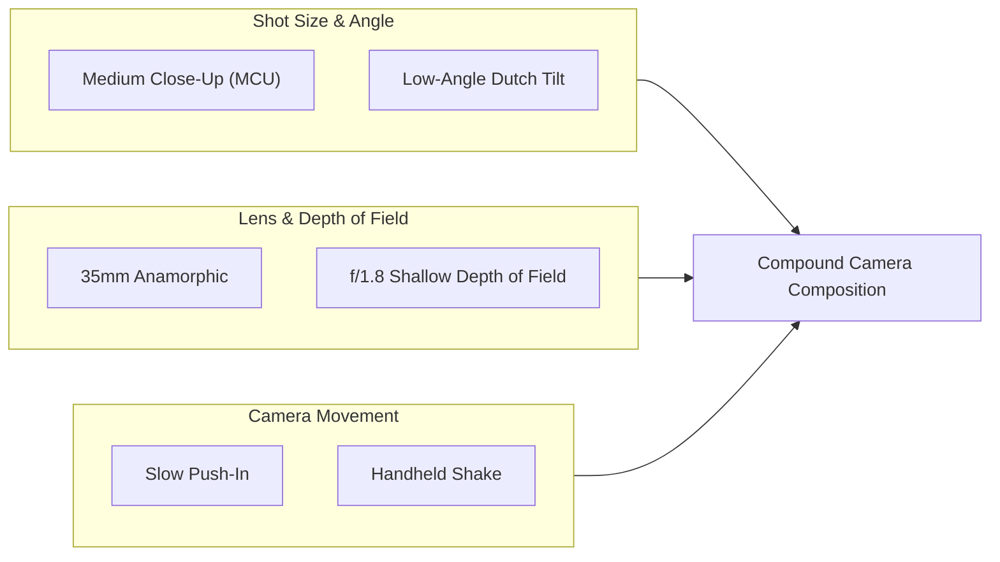
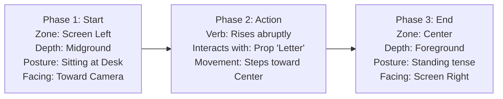

# Chapter 4: Authoring Scenes — Recipe Builder, Ensemble, Camera & Preflight

> *Part II: How to Use KRAKINAI (User & Director Guide)*  
> Previous: [Chapter 3: Library & Templates](./03-user-guide-library-and-templates.md) | Next: [Chapter 5: Directing Projects, Storyboards & Continuity](./05-user-guide-projects-and-continuity.md)

---

## 1. Overview: The Scene as a Film Set

In KRAKINAI, the **Scene Builder** is not a simple prompt text editor. It is an interactive digital soundstage where you direct actors, place lights, select lenses, block movement across time, and choreograph camera motion before compiling the result into prompt code.

This chapter walks through the full scene authoring workflow:
- Context-Aware Shot Types and dynamic slot requirements.
- Single-Character and Multi-Character Ensemble setups.
- Spoken Dialogue and the Performance Studio.
- The Cinematography Studio (lenses, angles, compound movements).
- Spatial Shot Blocking (v5) and Keyframe Planning (v6).
- Automated Preflight checks (`P000`–`P008`).
- Managing Saved Scene lineages, soft-archives, and bulk operations.

---

## 2. Context-Aware Shot Types

Every scene begins by establishing its narrative intent through a **Context-Aware Shot Type**. Selecting a shot type dynamically configures the builder slots:

| Shot Type | Purpose | Required Slots | Optional Slots | Inapplicable Slots |
| :--- | :--- | :--- | :--- | :--- |
| **`character_scene`** | Narrative dialogue, emotional beats, character choreography. | `character` | `wardrobe`, `environment`, `action`, `camera`, `lighting`, `style` | *None* |
| **`property_environment`** | Establishing shots, architectural tours, landscapes, world-building. | `environment` | `camera`, `lighting`, `style`, `action` | `character`, `wardrobe` |
| **`graphic_motion`** | Kinetic typography, title sequences, UI animations, holographic displays. | `style` | `action`, `camera`, `lighting` | `character`, `wardrobe`, `environment` |
| **`existing_footage`** | B-roll integration, reference clips, historical archival transitions. | `sourceMedia` | `style`, `camera` | `character`, `wardrobe` |

> [!NOTE]
> If you select `property_environment`, KRAKINAI automatically greys out the Character and Wardrobe slots. The Preflight engine will prevent visual contradictions by ensuring human anatomy rules are not evaluated against mountain ranges or cityscapes.

---

## 3. Single-Character vs Multi-Character Ensemble Authoring

### Single-Character Authoring
For simple shots focusing on one subject, bind an asset to the **Character** slot and an optional variant to the **Wardrobe** slot. You can add specific `sceneInstructions` or slot-level `overrideText` to tweak details for this shot only.

### Multi-Character Ensemble Authoring
When two or more characters share the screen (or when an off-camera voice speaks), toggle **Ensemble Mode**:
1. In the Scene Builder, click **Enable Ensemble**.
2. Click **Add Participant** for each character:
   - **ID**: Assign a local handle (e.g., `p-detective`, `p-witness`).
   - **Character Asset**: Select the Character asset from your library.
   - **Wardrobe**: Select the appropriate Outfit variant for each participant.
   - **Role**: Assign a narrative tag (e.g., *"Interrogator"*, *"Suspect"*).
   - **Presence**: Choose `'on_camera'` (physically visible) or `'off_camera'` (speaking from beyond the frame border).
   - **Identity Source**: Select whether to inject the character's full master prompt or their locked `'approved_anchor'`.
3. Set the **Primary Participant**: Designate the focal hero character who anchors the camera framing.

---

## 4. Spoken Dialogue & The Performance Studio

### Timed Dialogue Cues
In video production, dialogue must fit the shot's duration. Under the **Dialogue & Audio** section:
- Click **Add Dialogue Cue**.
- Select the speaking participant.
- Enter the **Line Text** (verbatim spoken words).
- Set the **Timing**:
  - `startSeconds` (e.g., `1.5s`): Time into the shot when speech begins.
  - `endSeconds` (e.g., `4.0s`): Time when speech finishes.
- Choose caption preferences (`none`, `spoken`, `requested`).

### The Performance Studio (V2 Psychological Direction)
To avoid flat, robotic AI character generations, open the **Performance Studio** drawer on any cue:
- **Primary & Secondary Emotion**: Choose from the psychological emotion catalog (e.g., *Apprehension*, *Guarded Vulnerability*, *Simmering Rage*).
- **Intensity Slider**: Set the dramatic volume:
  - `subtle`: Micro-expressions, slight tension around the eyes.
  - `moderate`: Clear facial changes, audible voice inflection.
  - `intense`: Pronounced physical reactions, voice crack or projection.
  - `explosive`: High dramatic climax, shouting, tears.
- **Voice Acoustic Fields**: Direct vocal texture (*warm*, *gravelly*, *hushed*, *staccato*, *monotone*).
- **Body Language & Gestures**: Select physical gestures from the catalog (e.g., *averted gaze*, *nervous finger tap*, *defensive chin tuck*).

---

## 5. Cinematography Studio: Framing, Lenses & Motion

KRAKINAI integrates a comprehensive film camera engine built on real-world cinematographic principles.

### Choosing Framing and Angles
- **Shot Sizes**: Extreme Close-Up (`ECU`), Close-Up (`CU`), Medium Close-Up (`MCU`), Medium Shot (`MS`), Full Shot (`FS`), Wide Long Shot (`WS`), Extreme Wide Shot (`EWS`).
- **Camera Angles**: Eye-Level, Low-Angle (empowering the subject), High-Angle (diminishing the subject), Dutch Tilt (conveying psychological disequilibrium), Bird's-Eye View.

### Camera Movement & Arrangement
Select movements from the catalog: `slow_push_in`, `dolly_zoom` (Vertigo effect), `lateral_tracking`, `crane_down`, `orbit_360`, or `subtle_handheld`.
Choose the **Arrangement**:
- **Simultaneous**: Movements happen at the same time (e.g., panning left while tracking forward).
- **Sequence**: First hold static, then push in on second 4.
- **Compound**: Multi-axis crane and gimbal movement.

### Lens Parameters
Under **Optical Parameters**, set exact physical values:
- **Focal Length**: e.g., `24mm` (expansive wide), `50mm` (natural human vision), `85mm` (portrait compression).
- **Aperture / DOF**: e.g., `f/1.4` (dreamy blurred background) vs `f/8` (deep focus showing all background details).

---

## 6. Spatial Shot Blocking (v5)

Most AI video generators produce floaty, ungrounded movement because prompts say *"two people talk"* without describing where they stand or where they walk. KRAKINAI's **v5 Shot Blocking** solves this.

### The 3-Phase Spatial Model (`Start -> Action -> End`)
For each participant in the scene, define their choreography across three distinct phases:

1. **Start Phase**:
   - `zone`: Screen placement (`screen_left`, `center`, `screen_right`).
   - `depth`: Depth plane (`foreground`, `midground`, `background`).
   - `posture`: Stance (`standing`, `sitting`, `crouching`, `walking`).
   - `facing`: Body and head direction (`toward_camera`, `away_from_camera`, `screen_left`, `screen_right`).
2. **Action Phase**:
   - `verb`: Explicit physical action (e.g., *"turns sharply and slams hands on the mahogany desk"*).
   - `interaction`: Linked interaction with a `Prop` or another `Participant`.
3. **End Phase**:
   - The concluding zone, depth, and posture before the cut.

### Placing Landmarks and Props
Add physical anchors to ground the scene:
- **Landmarks**: Permanent set features (e.g., *"Mahogany Executive Desk"*, *"Arched Cathedral Window"*).
- **Props**: Movable items held or manipulated by actors (e.g., *"Torn Telegram"*, *"Revolver"*).

---

## 7. Keyframes & Image Prompt Studio (v6)

For high-end video workflows using models like **Google Flow**, **Kling**, or **Runway Gen-3**, generation quality increases dramatically when you feed the video model **verified still images** for the first and last frames.

### How Keyframe Planning Works
1. Open the **Keyframes** tab in the Scene Builder.
2. Click **Generate Keyframe Plan**. KRAKINAI automatically creates two canonical frame targets:
   - **`frame-start`**: The visual state at `0.0s`.
   - **`frame-end`**: The visual state at the concluding second.
3. Review the **Derived Frame Prompts**:
   - KRAKINAI's prompt compiler automatically extracts continuous motion descriptors and converts them into pristine photographic prompts tailored for Midjourney, Flux, or Stable Diffusion.
4. Render the start and end images in your external image generator.
5. In the Media Vault, link the resulting images to the frame IDs via **Frame Image Association**.
6. When exporting for Google Flow, KRAKINAI supplies the exact image URLs alongside the video motion instructions.

---

## 8. Preflight Checks & Real-Time Conflict Detection

As you author scenes, KRAKINAI runs an automated rule engine in the background to catch prompt contradictions before you save. Findings appear in the live **Preflight Bar**:

| Rule ID | Severity | Name | What Triggers It | Recommended Action |
| :--- | :--- | :--- | :--- | :--- |
| **`P000`** | `blocking` | Schema / Field Violation | Missing scene title, empty dialogue cue, or unresolvable asset reference. | Complete the required field. |
| **`P001`** | `review` | Direct Gaze with Rear Camera | Prompt says *"camera is positioned behind character"* while also requesting *"looks directly into lens"*. | Pick a front/three-quarter camera position or remove direct eye contact. |
| **`P002`** | `review` | Camera Movement Conflict | Prompt requests *"static locked-off tripod"* while also specifying *"camera tracks forward"*. | Choose either static hold or dynamic camera move. |
| **`P003`** | `review` | Time-of-Day Clash | Lighting says *"bright midday sun"* while environment specifies *"midnight rain"*. | Reconcile environment time with lighting setup. |
| **`P004`** | `information` | Style / Medium Clash | Photorealistic 35mm film stock mixed with 3D cartoon animation styles. | Verify intentional stylistic juxtaposition. |
| **`P005`** | `review` | Speaker / Character Mismatch | Dialogue cue speaker name does not match the bound Character asset name. | Verify if dialogue is spoken by an off-camera narrator. |
| **`P006`** | `blocking` | Outfit Parent Mismatch | Selected Outfit variant belongs to Character A, but slot is bound to Character B. | Select an Outfit owned by the bound Character. |
| **`P007`** | `review` | Obscured Visible Speech | Line is on-camera dialogue, but camera framing is Extreme Long Shot or character faces away. | Use close/medium shot or switch dialogue to voiceover. |
| **`P008`** | `review` | Missing Media Reference | A linked reference image ID cannot be found in local storage. | Relink the media asset from the Media Vault. |

---

## 9. Managing Saved Scenes & Revision Lineage

Once a scene passes preflight, click **Save Scene**.

### Creating Revisions vs New Takes
- **Save as Revision**: When refining an existing take (e.g., fixing a lighting typo). KRAKINAI creates Version 2, updates the `headId` pointer, and preserves Version 1 in the revision drawer.
- **Save as New Take**: When testing an alternate creative concept (e.g., testing an intense emotional delivery vs a whispered delivery). This branches Take 2 as an independent sibling on the same storyboard shot.

### Inspecting Outputs & Comparing Diffs
Open **Saved Scenes** from the main menu:
- Click **Compare Revisions** to view side-by-side textual diffs between Take 1 and Take 2.
- Inspect the 3 compiled output formats:
  - **Full Output**: Complete assembled prompt with all sensory layers.
  - **Structured Output**: JSON-formatted component breakdown.
  - **Compact Output**: Shorthand token-optimized prompt.

### Soft-Archive & Bulk Actions
- **Soft-Archive**: Click the archive icon on any take to hide it from your active storyboard without deleting its historical record. You can restore archived takes at any time by toggling the filter to `Archived`.
- **Bulk Delete**: Select multiple unused draft takes and click **Delete Selected**. KRAKINAI verifies that none of the selected takes are currently active in any project storyboard before executing the deletion.

---

> **Next Up:** Continue to [Chapter 5: Directing Projects, Storyboards & Continuity](./05-user-guide-projects-and-continuity.md) to learn how to sequence shots, maintain cast bibles, and verify spatial continuity across cuts.
