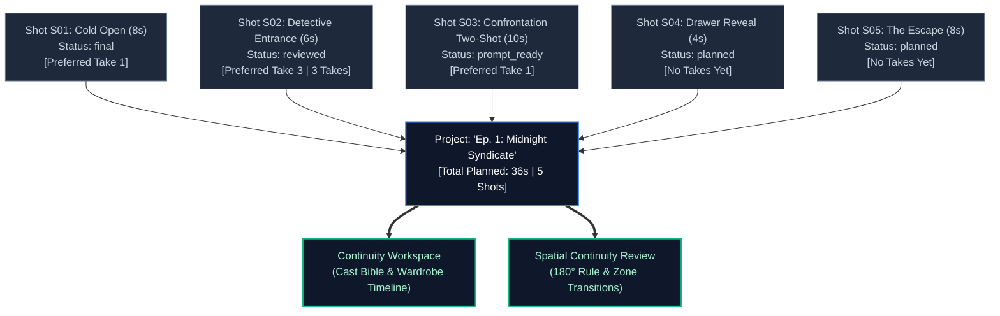
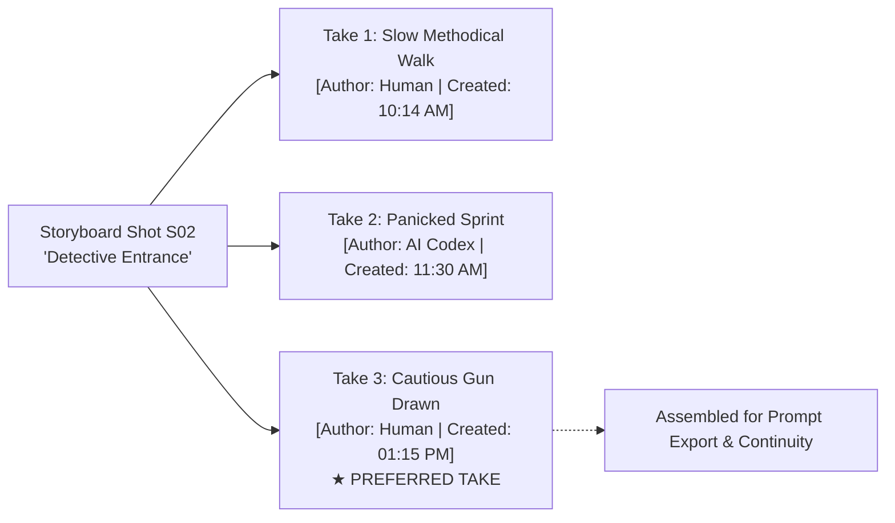
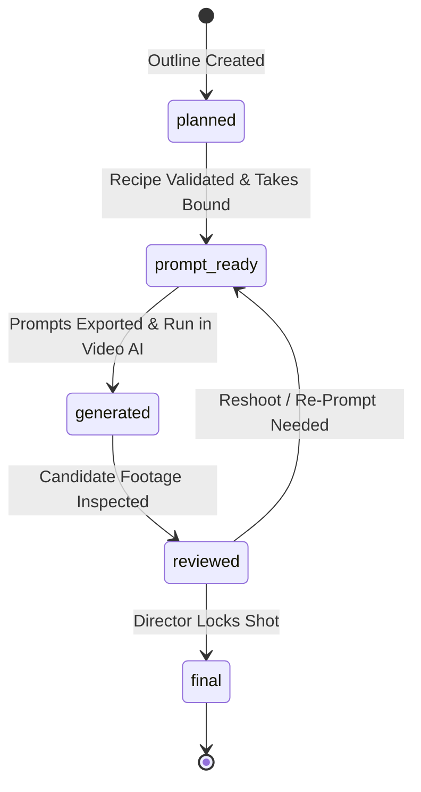
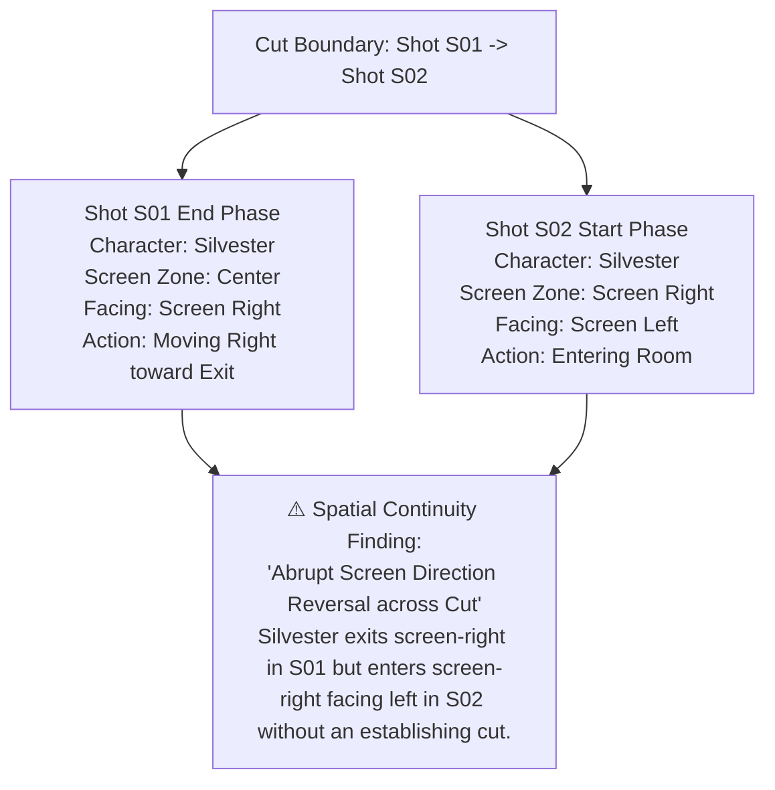

# Chapter 5: Directing Projects, Storyboards & Continuity

> *Part II: How to Use KRAKINAI (User & Director Guide)*  
> Previous: [Chapter 4: Scene Authoring](./04-user-guide-scene-authoring.md) | Next: [Chapter 6: Collaborating with AI Agents (MCP & Stage A/B Workflows)](./06-user-guide-ai-collaboration.md)

---

## 1. Overview: From Individual Shots to Episodic Narratives

A single stunning video clip does not make a film. Professional cinema relies on **continuous narrative momentum**: characters must remain wearing the same clothes across cuts, lighting must remain coherent across angles, and the spatial staging between Shot 1 and Shot 2 must follow the rules of physical geography and cinematic editing.

KRAKINAI provides a dedicated directorial suite under **Projects & Storyboard**:
- Storyboard Shot management with planned durations and codes.
- Multi-Take management and Preferred Take selection.
- Production status tracking from initial outline to locked final footage.
- The **Continuity Workspace** and **Cast Bible**.
- Automated **Spatial Continuity Review** detecting screen-direction flips and blocking contradictions.

---

## 2. Managing Projects and Storyboard Shots

### Creating a Project
1. Click **Projects** in the main navigation.
2. Click **New Project**.
3. Supply:
   - **Project Name**: (e.g., *"Pilot Episode: Neon Shadows"*).
   - **Description**: Summary of the episode or commercial concept.
   - **Planning Notes**: Broad directorial guidelines, aspect ratio goals (e.g., `16:9` cinematic letterbox), target pacing, or moodboard references.
4. Click **Create Project**.

### Adding and Configuring Shots
Inside your project, click **Add Shot** to create sequential storyboard beats:
- **Shot Code**: Standard editorial codes (e.g., `S01`, `S02`, `S02B`, `SC01-SH04`).
- **Title**: A quick narrative summary (e.g., *"Wide Establishing Shot of Pier 42"*).
- **Planned Shot Type**: Choose the target intent (`character_scene`, `property_environment`, `graphic_motion`, `existing_footage`).
- **Planned Duration**: Estimated duration in seconds (e.g., `4s`, `8s`). KRAKINAI tallies these durations into a live project runtime counter.
- **Continuity Notes**: Directorial reminders (e.g., *"Silvester must still be holding the umbrella from S01"*).

### Reordering Shots
Visual rhythm often changes in pre-production. You can drag and drop shot cards vertically to reorder them, or use the move up/down controls. When shots are reordered, KRAKINAI updates their sequence order while preserving all attached scene takes.

---

## 3. Takes & Preferred Take Selection

In film, a director shoots multiple takes to explore different actor performances or lighting setups. KRAKINAI models this exact workflow.

### Attaching Takes to a Shot
- **From the Storyboard**: Click **New Take** on any shot card to open the Scene Builder with the shot and project pre-linked.
- **From the Scene Builder**: Select an existing project and shot in the builder drawer and click **Save as Take**.
- Every shot card lists its available takes (`Take 1`, `Take 2`, etc.) with their duration and prompt preview.

### Selecting the Preferred Take
Only one take can represent the shot in the final cut. Click **Make Preferred Take** on your chosen take:
- The shot card badge updates to display the preferred take's title and thumbnail.
- The project runtime recalculates based on the preferred take's exact duration.
- The **Continuity Workspace** and **Spatial Continuity** engines immediately update their cast and blocking analysis using the new preferred take.

---

## 4. Production Status Lifecycle

KRAKINAI organizes storyboard shots into five production statuses, providing instant progress visibility across your production:

1. **`planned`**:
   - The shot outline exists on the storyboard with code and duration, but no scenes have been authored yet.
2. **`prompt_ready`**:
   - A scene take has been authored, preflight checks (`P000`–`P008`) have passed, and prompts are ready for external generation.
3. **`generated`**:
   - Prompts have been exported to an external video model (Google Flow, Kling, Runway, Midjourney), and candidate video clips are rendering.
4. **`reviewed`**:
   - The director has inspected the generated video or image outputs, linked the media into the Media Vault, and verified visual quality.
5. **`final`**:
   - The shot has been formally approved and locked for editorial timeline assembly.

To advance a shot's status, use the status dropdown on the shot card or have an AI assistant advance it via `krakinai_stage_shot_status`.

---

## 5. The Continuity Workspace & Cast Bible

Click the **Continuity** tab inside any project to open the **Continuity Workspace**. This automated engine cross-examines all shots in your sequence to ensure narrative and visual coherence.

### The Cast Bible Matrix
The Cast Bible automatically scans your storyboard's preferred takes and renders a cast participation matrix:

| Character | Shot S01 | Shot S02 | Shot S03 | Shot S04 | Shot S05 |
| :--- | :---: | :---: | :---: | :---: | :---: |
| **Silvester (Detective)** | Primary | On-Camera | Primary | — | On-Camera |
| **Marcus (Informant)** | — | Primary | On-Camera | — | — |
| **Shadow Assassin** | — | — | Off-Camera | Primary | Primary |

- Instantly spot when a character mysteriously disappears from a scene where they should be present.
- Identify multi-actor shots that require Ensemble or Shot Blocking refinement.

### The Wardrobe Timeline
Costume consistency is one of the most common failure modes in AI video. If a character is wearing a *"distressed brown leather jacket"* in Shot 1, they should not suddenly be wearing a *"blue denim jacket"* in Shot 2 unless an intentional costume change occurred.

The Wardrobe Timeline tracks the bound Outfit variant for each character across chronological shots:
- **Green Links**: Indicate identical Outfit variant IDs across cuts.
- **Amber Warning Badges**: Highlight costume changes between adjacent shots. If the change was unintentional, click the warning to align the Outfit variant with the predecessor shot.

### Shot-to-Shot Transitions
The workspace analyzes every cut boundary ($S_{n} \to S_{n+1}$):
- **Environment Continuity**: Verifies that shots intended to take place in the same location reference identical Environment assets.
- **Lighting Coherence**: Flags jarring shifts in time of day (e.g., daytime interior cutting to midnight rain without an establishing transition).

---

## 6. Spatial Continuity Review: Maintaining Physical Geography

In film editing, spatial continuity preserves the viewer's mental map of the scene. If an actor is looking screen-left toward another actor, the reverse shot must look screen-right (the **180-Degree Rule**). Similarly, if a character is running left-to-right, cutting to a shot of them running right-to-left makes them appear to have turned around.

KRAKINAI's **Spatial Continuity Review** evaluates the v5 Shot Blocking data across consecutive shots:

### What Spatial Continuity Checks
1. **Screen Direction Continuity**:
   - Detects when moving subjects reverse their screen travel direction across cuts without an intervening neutral angle.
2. **Eyeline Matches**:
   - Verifies that two interacting characters in alternating reverse angles look in complementary directions (e.g., Actor A looks screen-right, Actor B looks screen-left).
3. **Actor Zone Flips**:
   - Checks whether two characters standing side-by-side swap their left/right screen positions between cuts.
4. **Depth Jumps**:
   - Warns when an actor jumps abruptly from background to foreground between shots without physical movement.

### Reviewing Advisory Findings
Spatial continuity findings are **advisory review warnings**, not hard errors. (In cinematic grammar, directors occasionally break the 180-degree line deliberately for psychological disorientation). The findings provide clear explanations, pointing you directly to the offending blocking phase so you can adjust starting postures or camera placement before external generation begins.

---

> **Next Up:** Continue to [Chapter 6: Collaborating with AI Agents (MCP & Stage A/B Workflows)](./06-user-guide-ai-collaboration.md) to discover how external AI tools can co-direct your projects with strict human review.
