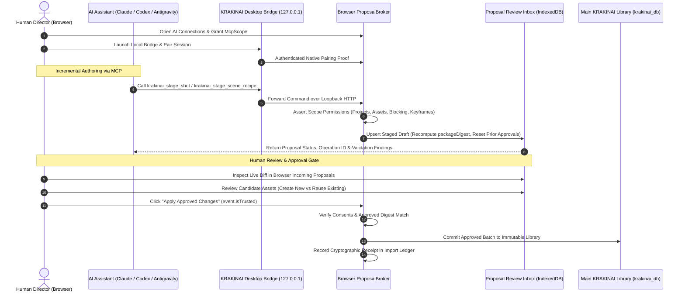
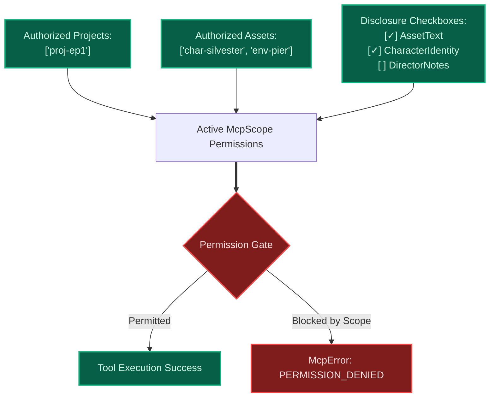
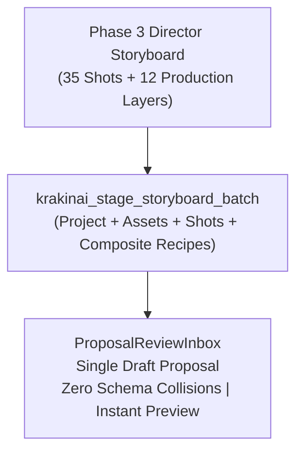
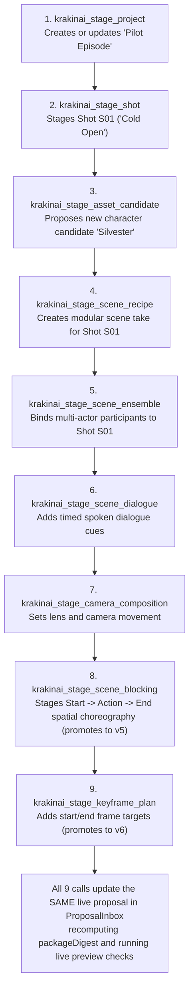
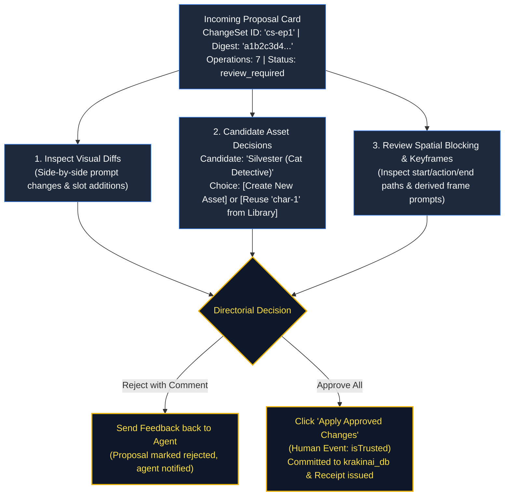

# Chapter 6: Collaborating with AI Agents (MCP & Stage A/B Workflows)

> *Part II: How to Use KRAKINAI (User & Director Guide)*  
> Previous: [Chapter 5: Projects, Storyboards & Continuity](./05-user-guide-projects-and-continuity.md) | Next: [Chapter 7: Internal Engines — Prompt Assembler, Catalogs & Validators](./07-inside-krakinai-engines.md)

---

## 1. Overview: The Philosophy of Human-Governed AI

Most AI coding and creative tools either give the AI complete read/write access to user files or force the human to manually copy-paste text back and forth. KRAKINAI takes a fundamentally different path: **cryptographically governed pair directing**.

In KRAKINAI:
- AI agents can explore existing project outlines, inspect asset catalogs, and author complex multi-shot storyboards.
- However, **no AI agent can ever write directly to your local database**.
- Every proposed shot, asset, or scene modification enters the **Proposal Review Inbox** as an uncommitted draft.
- You review the visual diffs, approve or reject specific candidate assets, and apply the final batch with an explicit, trusted human click (`event.isTrusted`).



KRAKINAI supports two collaboration workflows:
1. **Workflow 1: Manual Stage A/B File Exchange** (for web LLMs like ChatGPT, Claude.ai, or air-gapped environments).
2. **Workflow 2: Live Local MCP Connection** (for Claude Desktop, Codex CLI, Antigravity, or Cursor).

---

## 2. Workflow 1: Manual Stage A Context Export & Stage B Change-Set Import

When you do not have a live local bridge running, you can collaborate via standard JSON files.

### Step 1: Exporting Stage A Context
1. In KRAKINAI, open **Projects** and select your project.
2. Click **Export AI Context (Stage A)**.
3. KRAKINAI packages:
   - The project title, description, and storyboard shot outline.
   - List of authorized library assets (names, categories, IDs, and compact descriptions).
   - Cinematography, performance, and shot type guidelines.
4. Download the generated `stage-a-context.json` file.

### Step 2: Prompting the External AI
Upload `stage-a-context.json` to your AI model (ChatGPT, Claude, etc.) along with your creative brief:
> *"I have attached my KRAKINAI project context. Please author scene recipes for shots S01 and S02 using my existing character 'Silvester' (ID: char-silvester). Return your output as a valid KRAKINAI Stage B Change-Set JSON package adhering to the v3 schema."*

### Step 3: Importing Stage B Change-Sets
1. Copy the JSON response from your AI or save it as `change-set.json`.
2. In KRAKINAI, navigate to **AI Connections** $\to$ **Import Proposal (Stage B)**.
3. Paste the JSON or drag the file into the importer.
4. KRAKINAI's schema validator evaluates the payload against schemas `v1` through `v6`.
5. If valid, the proposal is admitted to your **Incoming Proposals Review Inbox** for visual review.

---

## 3. Workflow 2: Live Local MCP Connection

The most powerful way to co-direct in KRAKINAI is through the **Model Context Protocol (MCP)** using the pre-built desktop bridge.

### Launching the Desktop Bridge
The KRAKINAI bridge runs locally on your machine and communicates over standard input/output (stdio) with MCP host clients:
```powershell
node bridge/dist/index.js
```

### Configuring MCP Host Clients
Add KRAKINAI to your MCP configuration file (e.g., `claude_desktop_config.json` or Antigravity's MCP configuration):
```json
{
  "mcpServers": {
    "krakinai": {
      "command": "node",
      "args": ["C:/Users/YourName/dev/krakinai/bridge/dist/index.js"]
    }
  }
}
```

### Establishing the Native Browser Pairing
1. Open KRAKINAI in your Chromium-based browser (Chrome, Edge, Brave).
2. Navigate to **AI Connections**.
3. Under **Local MCP Bridge**, observe the live pairing indicator.
4. When your MCP client starts, the desktop bridge negotiates an authenticated HMAC pairing proof with KRAKINAI over loopback HTTP (`127.0.0.1`).
5. Once paired, the status switches to **Connected** with an active session indicator.

---

## 4. Permission Governance: The `McpScope` Security Boundary

KRAKINAI gives you surgical control over what the connected AI can read and stage. Under **AI Connections**, configure the active **`McpScope`**:



### Scope Disclosure Controls
- **`authorizedProjectIds`**: Check the specific projects the agent is permitted to inspect or stage shots for. All other projects remain invisible.
- **`authorizedAssetIds`**: Check specific library assets. Unauthorized assets are redacted from search and read tools.
- **`includeAssetText`**: When unchecked, asset prompt texts and descriptions are redacted. The AI sees only titles and categories.
- **`includeCharacterIdentity`**: When unchecked, character Identity Anchors (`immutableTraits`, `prohibitedDrift`) are redacted.
- **`includeNotes`**: When unchecked, private director notes are completely withheld.
- **`fullPromptSceneIds`**: Explicitly grants full prompt visibility to individual scenes. (Scenes not on this list return redacted assembly previews).

### Proposal Capability Gates
- **`allowProposals`**: Master write gate. When unchecked, all `krakinai_stage_*` tools fail with `PERMISSION_DENIED`.
- **`allowBlockingProposals`**: Enables v5 Shot Blocking staging. Requires pairing with an MCP client that supports `blocking-v5` capabilities.
- **`allowKeyframeProposals`**: Enables v6 Keyframe and frame image staging. Requires pairing with an MCP client that supports `keyframes-v6` capabilities.

---

## 5. Storyboard Authoring via Batch & Granular Staging Tools

AI agents can author storyboards using either **Atomic Batch Staging** (`krakinai_stage_storyboard_batch`) or **Granular Step-by-Step Staging**:

### A. Atomic Batch Staging (`krakinai_stage_storyboard_batch`)
For large sequences and full multi-shot episodes (e.g. from Phase 3 Director Storyboards), an AI agent can stage the entire project container, candidate assets (base characters, wardrobe states, environments, styles), shot list, and composite scene recipes in a single atomic tool call:



The batch staging engine automatically sorts operations into dependency-safe order, normalizes camera shorthand aliases to official catalog IDs, handles multi-actor ensemble participants and spoken dialogue cues, and validates duration boundaries.

### B. Granular Step-by-Step Staging (`krakinai_stage_*`)
For iterative revisions, shot additions, or granular dialogue tweaks, agents author storyboards **shot-by-shot and layer-by-layer**:



### Key Mechanical Features of Incremental Staging
1. **Unified `changeSetId`**: Passing the same `changeSetId` (e.g., `"cs-ep1"`) across multiple calls updates the same draft proposal in place inside the Review Inbox.
2. **Canonical Dependency Ordering**: No matter what order the agent calls the tools in, KRAKINAI deterministically sorts operations internally: Assets $\to$ Projects $\to$ Shots $\to$ Scenes $\to$ Takes & Images.
3. **Automatic Schema Promotion**:
   - Calling basic tools produces a `krakinai.change-set.v3` draft.
   - Calling `krakinai_stage_scene_blocking` automatically promotes the draft to **`v5`**.
   - Calling `krakinai_stage_keyframe_plan` or `krakinai_stage_frame_image` automatically promotes the draft to **`v6`**.
4. **Approval Reset Safeguard**: If a human reviewer in the browser partially reviewed a proposal and the AI subsequently calls another `krakinai_stage_*` tool on that draft, KRAKINAI automatically resets prior approvals to `emptyChangeSetApproval()`. This ensures a human never accidentally approves a mutated batch with stale decisions.

---

## 6. Reviewing Proposals in the Incoming Proposals Inbox

When an AI agent finishes staging operations, navigate to **AI Connections** $\to$ **Incoming Proposals**.



### 1. Inspecting Visual Diffs
Click on any proposal card to expand its operation checklist. For each staged operation, KRAKINAI displays:
- What project or shot is being created or modified.
- Full textual diffs highlighting newly proposed prompts or camera instructions.
- Batch preflight findings and validation status.

### 2. Candidate Asset Review (Create vs Reuse)
When an AI proposes a new character or environment, it creates an `asset.propose` candidate. In the review UI, KRAKINAI offers two options:
- **Create New**: Approves the candidate as a brand-new permanent asset in your library.
- **Reuse Existing**: Allows you to point the proposed shot to an existing library asset instead, automatically remapping all downstream scene references to the existing asset ID!

### 3. Rejecting with Feedback
If an AI's proposal misses the creative mark:
1. Click **Reject with Feedback**.
2. Type specific directorial revision notes (e.g., *"Make Shot S02 a low-angle medium close-up instead of a wide shot, and remove the rain environment"*).
3. Click **Confirm Rejection**.
4. The proposal is marked `rejected`, and the AI agent can read your feedback via `krakinai_get_proposal_status` to stage an updated revision.

### 4. Applying the Approved Batch
Once all operation choices are made:
1. Verify that no blocking preflight errors remain.
2. Click **Apply Approved Changes**.
3. KRAKINAI verifies that the click originated from a genuine human interaction (`event.isTrusted`), validates the `approvedDigest`, writes all changes into `krakinai_db` in a single atomic transaction, and emits an immutable **Import Receipt** into your audit ledger.

---

> **Next Up:** Continue to [Chapter 7: Internal Engines — Prompt Assembler, Catalogs & Validators](./07-inside-krakinai-engines.md) to explore the deterministic compiler and catalogs under the hood.
