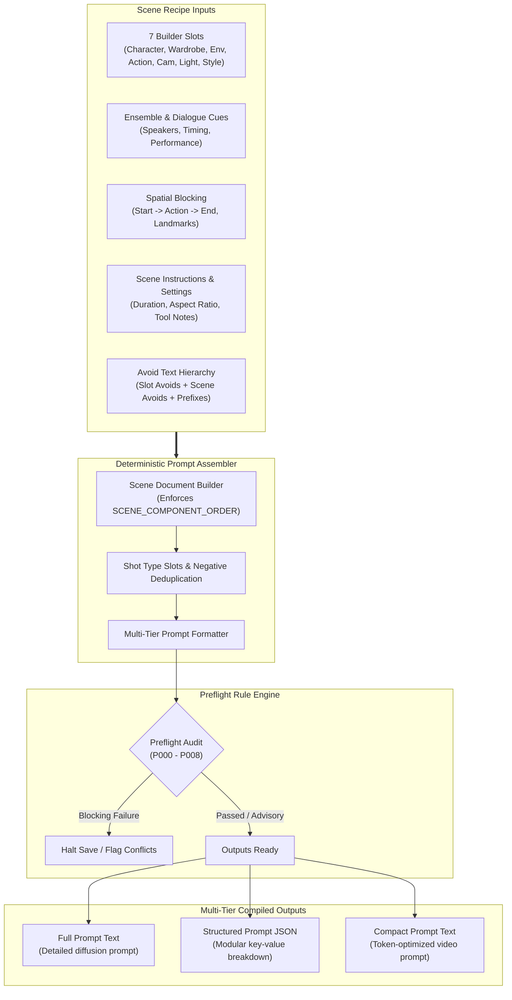

# Chapter 7: Internal Engines — Prompt Assembler, Catalogs & Validators

> *Part III: What's Inside KRAKINAI (Subsystem Deep Dive)*  
> Previous: [Chapter 6: Collaborating with AI Agents](./06-user-guide-ai-collaboration.md) | Next: [Chapter 8: System Architecture, Data Model & Storage](./08-technical-architecture-and-storage.md)

---

## 1. Overview: The Compiler Under the Hood

KRAKINAI is architected around the belief that visual storytelling prompts should be compiled by a deterministic software pipeline rather than generated haphazardly. Just as a modern compiler transforms high-level source code into machine bytecode, KRAKINAI's **Prompt Assembly Pipeline** transforms structured scene recipes into clean, model-optimized prompts.

This chapter details the internal mechanics of:
1. The **Prompt Assembler** (`sceneDocument.ts` & `promptAssembler.ts`) and its strict component hierarchy.
2. The multi-tier output formats: **Full**, **Structured**, and **Compact**.
3. The built-in deterministic **Cinematography Catalog** (`cinematographyCatalog.ts`).
4. The built-in **Performance & Emotion Catalog** (`performanceCatalog.ts`).
5. The **Shot Type Rule Engine** (`shotTypeRules.ts`).
6. The **Preflight Validation Rule Engine** (`scenePreflight.ts`), detailing rules `P000` through `P008`.



---

## 2. The Deterministic Prompt Assembly Pipeline

### Component Precedence (`SCENE_COMPONENT_ORDER`)
When compiling a scene recipe, KRAKINAI enforces a strict, tested component order defined in `SCENE_COMPONENT_ORDER`:
```typescript
export const SCENE_COMPONENT_ORDER = [
  'character',
  'wardrobe',
  'environment',
  'action',
  'camera',
  'lighting',
  'style',
] as const;
```

Why this exact order?
1. **Subject Anchor First (`character`)**: Diffusion and video models assign the highest semantic weight to tokens appearing early in the prompt. Establishing character anatomy and face structure first prevents the background from bleeding into the character's facial features.
2. **Costume Context (`wardrobe`)**: Adjoins directly to the character so clothing tokens modify the subject rather than surrounding props.
3. **World Setting (`environment`)**: Establishes the physical boundaries and atmosphere surrounding the subject.
4. **Locomotion & Gesture (`action`)**: Describes physical kinetics within the established environment.
5. **Optics & Composition (`camera`)**: Directs the lens, angle, and framing of the scene.
6. **Illumination (`lighting`)**: Dictates color temperature, shadows, and key/fill ratios.
7. **Medium & Finish (`style`)**: Dictates grain, film stock, shutter speed, and aesthetic render medium.

### Auxiliary Section Formatting
Following the 7 primary slots, the compiler appends auxiliary blocks in canonical sequence:
- **Dialogue & Audio**: Formatted as `Dialogue: "[Speaker]" speaks with [Delivery]: "[LineText]"`.
- **Spatial Blocking**: Injected as an articulated staging block describing participant start positions, physical actions, and end states.
- **Scene Instructions**: Specific directorial notes appended to fine-tune generative nuances.

### Negative & Avoid Text Hierarchies
KRAKINAI merges negative prompts hierarchically:
1. Slot-level `avoidText` from bound library assets.
2. Template-level `inheritedAvoidPrefix`.
3. Scene-level `avoidText`.
The compiler deduplicates tokens, normalizes punctuation, and produces a single cohesive negative prompt block.

---

## 3. Multi-Tier Output Formats

KRAKINAI compiles every scene into three simultaneous formats:

### 1. Full Output (`outputs.full`)
- **Target**: High-fidelity text-to-image diffusion models (Midjourney, Flux, Stable Diffusion XL) and narrative preview tools.
- **Characteristics**: Comprehensive sensory vocabulary, combining all 7 slots, full identity descriptions, dialogue cues, and lighting aesthetics into a continuous, grammatically cohesive prompt.

### 2. Structured Output (`outputs.structured`)
- **Target**: Programmatic integrations, metadata pipelines, and automated asset tagging.
- **Characteristics**: A structured JSON object breaking down each individual component, slot title, asset revision, and optical parameter.

### 3. Compact Output (`outputs.compact`)
- **Target**: Token-constrained video models (Google Flow, Kling, Runway Gen-3, Luma Dream Machine, Sora).
- **Characteristics**: Uses each asset's `compactText` shorthand, stripping redundant adjectives and emphasizing action verbs, camera movement, and subject positioning.

---

## 4. Built-In Cinematography Catalog

KRAKINAI includes a standardized, film-grade cinematography catalog in `cinematographyCatalog.ts` and `cinematography.ts`.

### Preset Families
- **`shotSize`**: Standard framing dimensions:
  - `shot-size.extreme-close-up`: Focuses strictly on eyes, mouth, or small props.
  - `shot-size.close-up`: Face from chin to forehead.
  - `shot-size.medium-close-up`: Chest to top of head (industry dialogue standard).
  - `shot-size.medium-shot`: Waist up.
  - `shot-size.full-shot`: Full human figure from head to toe.
  - `shot-size.wide-long-shot`: Character integrated into broad environment.
  - `shot-size.extreme-wide-shot`: Landscape dominates; human figures tiny.
- **`angle`**:
  - `angle.eye-level`: Neutral observer perspective.
  - `angle.low-angle`: Camera looks upward, granting psychological power.
  - `angle.high-angle`: Camera looks downward, conveying vulnerability.
  - `angle.dutch-tilt`: Canted horizon evoking tension or disorientation.
  - `angle.birds-eye`: Perpendicular overhead shot.
- **`movement`**:
  - `movement.static`: Locked-off tripod shot.
  - `movement.slow-push-in`: Gradual optical or physical movement toward subject.
  - `movement.pull-back-reveal`: Camera recedes to reveal new narrative context.
  - `movement.tracking-shot`: Lateral or forward movement parallel to moving subject.
  - `movement.orbit`: 360-degree rotation around focal subject.
  - `movement.handheld`: Organic, subtle human camera operator motion.

### Optical & Lens Parameters
- **Focal Length**: Discrete millimeter values (`24mm`, `35mm`, `50mm`, `85mm`, `135mm`).
- **Aperture & Depth of Field**: Calculated blur discs (`f/1.4`, `f/1.8`, `f/2.8`, `f/5.6`, `f/11`).
- **Arrangement Modes**: `'simultaneous'` (conjoined techniques), `'sequence'` (staged timing), and `'compound'` (multi-axis motion).

---

## 5. Built-In Performance Catalog

KRAKINAI's **Performance Studio** (`performanceCatalog.ts`) maps psychological and dramatic vocal attributes into standardized tokens.

### Catalog Dimensions
1. **Emotions (`EMOTIONS`)**: 32 nuanced emotional states categorized into families:
   - *Vulnerability & Fear*: Apprehension, Dread, Helplessness, Melancholy.
   - *Conflict & Hostility*: Simmering Resentment, Contempt, Explosive Rage, Indignation.
   - *Determination & Power*: Cold Resolve, Defiance, Triumph, Stoic Authority.
   - *Intimacy & Connection*: Tenderness, Longing, Guarded Vulnerability.
2. **Emotional Intensities (`EMOTIONAL_INTENSITIES`)**:
   - `subtle`: Internalized, restrained, hinted in the eyes.
   - `moderate`: Visible emotional delivery with natural vocal modulation.
   - `intense`: Strong outward emotional expression, physical trembling or raised voice.
   - `explosive`: Full uninhibited theatrical climax, shouting or sobbing.
3. **Voice Acoustics (`VOICE_FIELDS`)**: Timbre, pitch (`gravelly`, `resonant`, `breathy`, `brittle`, `honeyed`, `booming`).
4. **Speech Delivery (`SPEECH_FIELDS`)**: Cadence and articulation (`clipped`, `drawled`, `staccato`, `faltering`, `deliberate`).
5. **Physical Gestures (`GESTURES`)**: Body language and micro-expressions (`clenched jaw`, `rapid blinking`, `averted glance`, `rigid spine`).

---

## 6. Context-Aware Shot Type Rule Matrices

The **Shot Type Rules Engine** (`shotTypeRules.ts`) enforces cinematic integrity by verifying that slot bindings match the shot's narrative purpose:

| Shot Type | Required Slots | Optional Slots | Inapplicable Slots | Source Media Allowed |
| :--- | :--- | :--- | :--- | :---: |
| **`character_scene`** | `character` | `wardrobe`, `environment`, `action`, `camera`, `lighting`, `style` | *None* | Yes |
| **`property_environment`** | `environment` | `camera`, `lighting`, `style`, `action` | `character`, `wardrobe` | No |
| **`graphic_motion`** | `style` | `action`, `camera`, `lighting` | `character`, `wardrobe`, `environment` | No |
| **`existing_footage`** | `sourceMedia` | `style`, `camera` | `character`, `wardrobe` | **Required** |

### Slot Cleaning & Normalization
When a user or AI switches a scene from `character_scene` to `property_environment`, KRAKINAI automatically clears inapplicable slots (`character`, `wardrobe`) to prevent phantom prompt injections.

---

## 7. The Preflight Validation Rule Engine (`P000`–`P008`)

KRAKINAI's Preflight engine (`scenePreflight.ts`) executes a deterministic audit over every scene draft. Findings are classified into three severity levels:
- **`blocking`**: Critical contradiction or missing required data. Prevents saving or submitting the scene.
- **`review`**: High-probability visual conflict. Requires human confirmation or editorial review.
- **`information`**: Advisory stylistic observation.

### Exhaustive Preflight Rules Table

| Rule ID | Severity | Name | What Causes the Violation | How to Resolve |
| :--- | :---: | :--- | :--- | :--- |
| **`P000`** | `blocking` | Schema / Field Violation | Missing title, invalid duration, empty spoken dialogue line, unresolvable asset reference ID, or blocking schema error. | Fill out the highlighted missing field or fix the malformed data. |
| **`P001`** | `review` | Direct Gaze with Rear Camera | Positive camera position clauses place camera behind the character (e.g. *"camera is behind subject"*, *"rear view"*), while character clauses specify direct eye contact (e.g. *"looks directly into camera"*, *"direct lens gaze"*). | Reposition camera to front/profile or remove direct eye contact directive. |
| **`P002`** | `review` | Static and Moving Camera Directions | Conflicting camera movements in the prompt: contains positive assertions of static hold (*"camera is locked off"*, *"static camera"*) alongside dynamic motion (*"camera dollies forward"*, *"tracking shot"*, *"handheld"*). | Choose either a static tripod shot or a dynamic movement. |
| **`P003`** | `review` | Conflicting Time-of-Day Directions | Positive daytime clauses (*"bright midday sun"*, *"morning daylight"*) combined with night clauses (*"nighttime"*, *"dark midnight"*, *"blue hour"*). | Align the lighting slot and environment slot to the same time of day. |
| **`P004`** | `information`| Photorealistic and Stylized Directions | Concurrently requests photorealistic 35mm film aesthetics alongside cartoon 3D animation or stylized rendering. | Confirm whether intentional hybrid look or remove conflicting style. |
| **`P005`** | `review` | Speaker Differs from Character | In single-character mode, the dialogue cue speaker name does not match the bound Character asset's title, and mode is not set to `voiceover` or `off_screen`. | Correct speaker name or set dialogue mode to `voiceover`. |
| **`P006`** | `blocking` | Variant Parent Character Mismatch | The Outfit variant bound to the Wardrobe slot has a `parentCharacterId` that does not match the Character asset currently bound to the Character slot. | Select an Outfit owned by the current Character or switch the Character. |
| **`P007`** | `review` | Visible Speech May Be Obscured | Dialogue cue is set to `on_camera` with lip-sync delivery, but the camera is an Extreme Wide Shot, or character's head is turned away, or face is obscured. | Frame subject in MCU/Close-Up or switch dialogue to `voiceover`. |
| **`P008`** | `review` | Missing Media Reference | A media link referenced by the scene's reference pack or source media links does not exist in local storage. | Re-attach media file from Media Vault or remove the broken link. |

---

> **Next Up:** Continue to [Chapter 8: System Architecture, Data Model & Storage](./08-technical-architecture-and-storage.md) to explore the technical underpinnings, IndexedDB storage schemas, and data structures.
