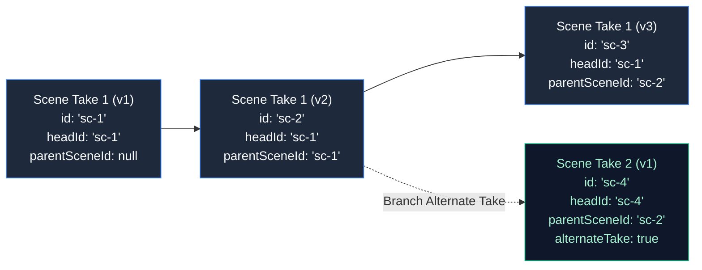

# Chapter 8: System Architecture, Data Model & Storage

> *Part IV: Detailed Technical Documentation*  
> Previous: [Chapter 7: Internal Engines — Prompt Assembler, Catalogs & Validators](./07-inside-krakinai-engines.md) | Next: [Chapter 9: Change-Set Contracts (v1–v6) & Security Model](./09-technical-changeset-and-security.md)

---

## 1. Overview: Local-First Engineering Principles

KRAKINAI is engineered as a **local-first, zero-telemetry, browser-native production suite**. Unlike cloud-hosted SaaS tools that hold your scripts, characters, and storylines on remote servers, KRAKINAI persists your entire creative universe locally on your machine using browser **IndexedDB**, isolated loopback networking, and cryptographic audit ledgers.

This chapter details:
1. The codebase structure and separation of concerns.
2. The two distinct IndexedDB databases (`krakinai_db` and `krakinai_review_inbox_db`).
3. Cross-tab concurrency control and Web Locks.
4. Immutable scene revision chains and take branching.
5. Canonical JSON serialization and cryptographic SHA-256 digests.

```mermaid
graph TD
    classDef ui fill:#0f172a,stroke:#3b82f6,stroke-width:2px,color:#f8fafc;
    classDef domain fill:#1e293b,stroke:#64748b,stroke-width:1px,color:#cbd5e1;
    classDef storage fill:#065f46,stroke:#10b981,stroke-width:2px,color:#d1fae5;
    classDef bridge fill:#7f1d1d,stroke:#ef4444,stroke-width:2px,color:#fee2e2;

    subgraph Presentation["UI Layer (React 18)"]
        UI["src/components/\n(Library, Builder, Storyboard, Inbox)"]
    end

    subgraph Logic["Domain Layer (Pure TypeScript)"]
        Domain["src/domain/\n(Assembler, Staging, Preflight, Canonical)"]
    end

    subgraph Data["Storage Layer (Browser IndexedDB)"]
        DB1["krakinai_db\n(8 Main Stores: Assets, Scenes, Collections...)"]
        DB2["krakinai_review_inbox_db\n(Review Inbox: 8 Staged Proposals)"]
    end

    subgraph IPC["External & Bridge Layer"]
        Broker["src/connections/proposalBroker.ts\n(Session Authority & Locks)"]
        BridgeNode["bridge/ (Node.js Process)\n(Loopback Relay & Stdio MCP Adapter)"]
    end

    UI --> Domain
    UI --> Data
    Domain --> Data
    Broker --> DB2
    BridgeNode <==>|Authenticated HTTP (127.0.0.1)| Broker
    Broker -.->|Confirmed Human Action Only| DB1

    class UI ui;
    class Domain domain;
    class DB1,DB2 storage;
    class Broker,BridgeNode bridge;
```

---

## 2. Codebase Organization & Directory Map

The KRAKINAI codebase enforces clean architectural separation:

```
krakinai/
├── src/
│   ├── types/               # Type definitions (domain models, MCP protocols, ChangeSets)
│   │   ├── domain.ts        # Assets, Scenes, Collections, Media, Settings
│   │   ├── changeSet.ts     # Change-Set schemas, operations, targets, approvals
│   │   ├── ensemble.ts      # Multi-actor participants, dialogue cues, timing
│   │   ├── blocking.ts      # v5 Shot Blocking (Start->Action->End, landmarks)
│   │   ├── keyframes.ts     # v6 Keyframes, derived still frames, media associations
│   │   ├── mcp.ts           # McpScope, capability grants, proposal views
│   │   └── proposalReview.ts# Review inbox records, progress, dispositions
│   │
│   ├── domain/              # Pure business logic (Zero React, deterministic algorithms)
│   │   ├── promptAssembler.ts      # Multi-tier prompt compilation
│   │   ├── sceneDocument.ts        # Component ordering and normalization
│   │   ├── mcpGranularStaging.ts   # Incremental ChangeSet builder & ordering
│   │   ├── mcpGranularReads.ts     # Scope-aware inspection tools
│   │   ├── scenePreflight.ts       # Preflight validation rule engine (P000-P008)
│   │   ├── changeSetCanonical.ts   # Canonical JSON sorting & SHA-256 hashing
│   │   ├── continuityWorkspace.ts  # Cast Bible & transition tracking
│   │   ├── blockingContinuity.ts   # 180-degree rule & screen direction analysis
│   │   └── mcpProtocol.ts          # 37 MCP tool schemas & argument validation
│   │
│   ├── storage/             # IndexedDB repositories and transactions
│   │   ├── db.ts                   # krakinai_db initialization & snapshot loaders
│   │   ├── proposalReviewInbox.ts  # krakinai_review_inbox_db persistence
│   │   ├── changeSets.ts           # Proposal admission & atomic application
│   │   └── sceneAuthoring.ts       # Revision lineage & draft commit operations
│   │
│   ├── connections/         # Network, IPC, and security boundaries
│   │   ├── proposalBroker.ts       # Browser authority, session state, tool routing
│   │   ├── proposalInbox.ts        # In-memory proposal caching & validation
│   │   └── proposalReviewLock.ts   # Cross-tab Web Lock coordination
│   │
│   └── components/          # React 18 UI components
│
├── bridge/                  # Standalone Node.js MCP Desktop Bridge
│   ├── src/
│   │   ├── registerTools.ts        # Tool registration with MCP SDK
│   │   ├── schemaDiscovery.ts      # Schema factoring for frame limits
│   │   ├── browserTransport.ts     # Loopback HTTP client
│   │   └── stdioAdapter.ts         # Stdio transport for Claude/Codex/Antigravity
│   └── build.mjs            # Standalone bridge packager
│
└── docs/                    # Technical specifications, QA guides, and Manual
```

---

## 3. IndexedDB Database Architecture

KRAKINAI partitions storage into **two isolated IndexedDB databases** to maintain an airtight boundary between your permanent creative assets and uncommitted AI proposals:

### Database 1: `krakinai_db` (The Production Library)
Contains 8 distinct object stores:
1. **`assets`**:
   - Stores `PromptAsset` records across all 7 categories.
   - Primary Key: `id` (UUID).
   - Indexes: `category`, `updatedAt`, `favorite`.
2. **`variants`**:
   - Stores Character-owned `Variant` (Outfit) records.
   - Primary Key: `id`.
   - Index: `parentCharacterId` (guarantees rapid relational lookup).
3. **`templates`**:
   - Stores reusable scene archetype `Template` records.
   - Primary Key: `id`.
4. **`scenes`**:
   - Stores all immutable `SavedScene` records across all versions and takes.
   - Primary Key: `id`.
   - Indexes: `headId`, `authoringMode`, `updatedAt`, `archivedAt`.
5. **`collections`**:
   - Stores project and storyboard records (`Collection`).
   - Primary Key: `id`.
   - Contains sequential shot definitions, planned durations, and take links.
6. **`drafts`**:
   - Working transient drafts (`SceneDraft`) in the Scene Builder.
7. **`preferences`**:
   - User settings, UI theme, AI connection preferences, and the **Import Ledger** (`importLedger`).
8. **`media`**:
   - Binary image and video media assets stored as Blobs or Base64 data URLs.

### Database 2: `krakinai_review_inbox_db` (The Uncommitted Proposal Staging Area)
Contains 1 dedicated object store:
- **`review_drafts`**:
  - Stores unapplied AI proposals (`ProposalRecord`).
  - Holds up to **8 proposals maximum** (`MCP_LIMITS.proposals = 8`).
  - Stores the full `ChangeSet`, calculated `packageDigest`, live `preview` validation state, and human `approval` decisions.
  - Automatically expires unreviewed proposals after 24 hours (`REVIEW_WINDOW_MS = 86400000`).

---

## 4. Concurrency Control & Web Locks

Because KRAKINAI runs in modern web browsers, users may have multiple tabs open simultaneously (e.g., editing a scene in Tab 1 while reviewing an incoming AI proposal in Tab 2).

To prevent race conditions, corrupted draft states, or split-brain proposal approvals:
- All mutations to `krakinai_review_inbox_db` and all proposal admissions in `ProposalBroker` are wrapped in **Web Locks** (`navigator.locks.request` via `proposalReviewLock.ts`).
- Locks are scoped per proposal ID: `krakinai:review-inbox:${proposalId}`.
- If Tab 1 is currently updating an unapplied draft ChangeSet, Tab 2 waits until the write transaction finishes before reading the fresh `packageDigest`.
- Applying an approved proposal acquires an exclusive lock, preventing duplicate execution.

---

## 5. Scene Lineage & Immutability Architecture

KRAKINAI treats scenes as an append-only directed acyclic graph (DAG):



### Lineage Fields
- **`id`**: Unique identifier for this exact immutable revision.
- **`headId`**: Identifies the lineage root. When a user creates a new revision of `sc-2`, the resulting scene `sc-3` retains `headId: 'sc-1'`.
- **`parentSceneId`**: Identifies the immediate ancestor scene.
- **`versionNumber`**: Incremental integer tracking chronological revision depth.

### Take Branching Rules
- **Revision (`alternateTake: false`)**: Updates the lineage pointer of the shot to the new version. The predecessor becomes historical.
- **Take (`alternateTake: true`)**: Establishes a new sibling branch (`headId` set to new ID). The shot adds this new take to its `takeSceneIds` list without unlinking the original.

---

## 6. Canonical Serialization & Cryptographic Digests

In distributed systems and security protocols, standard `JSON.stringify()` cannot be relied upon for cryptographic hashing because object key ordering is non-deterministic across JavaScript engines.

KRAKINAI implements a strict **Canonical JSON Serializer** (`changeSetCanonical.ts`):
1. **Deterministic Key Sorting**: Object keys are recursively sorted alphabetically using standard Unicode code-point collation.
2. **Whitespace Stripping**: Zero insignificant whitespace, newlines, or indentations are emitted.
3. **Number Normalization**: IEEE-754 numbers are normalized; exponential notations are formatted deterministically.
4. **UTF-8 Byte Encoding**: Text is converted to pure UTF-8 bytes.

### Package Digest Generation (`changeSetDigest`)
```typescript
import { canonicalStringify } from './changeSetCanonical';

export async function changeSetDigest(changeSet: ChangeSet): Promise<string> {
  const canonicalJson = canonicalStringify(changeSet);
  const buffer = new TextEncoder().encode(canonicalJson);
  const hashBuffer = await crypto.subtle.digest('SHA-256', buffer);
  return Array.from(new Uint8Array(hashBuffer))
    .map((b) => b.toString(16).padStart(2, '0'))
    .join('');
}
```

- When an AI agent submits a proposal via MCP, KRAKINAI computes its `packageDigest`.
- If the AI or any network proxy alters even a single character in a prompt or shot code, the hash changes completely.
- When the human clicks **Apply Approved Changes**, KRAKINAI re-computes the digest and matches it against the stored human consent token. If they do not match, the transaction rejects with `McpError('REVIEW_REQUIRED')`.

---

> **Next Up:** Continue to [Chapter 9: Change-Set Contracts (v1–v6) & Security Model](./09-technical-changeset-and-security.md) to explore the evolution of change-sets, operation payloads, and concurrency proofs.
