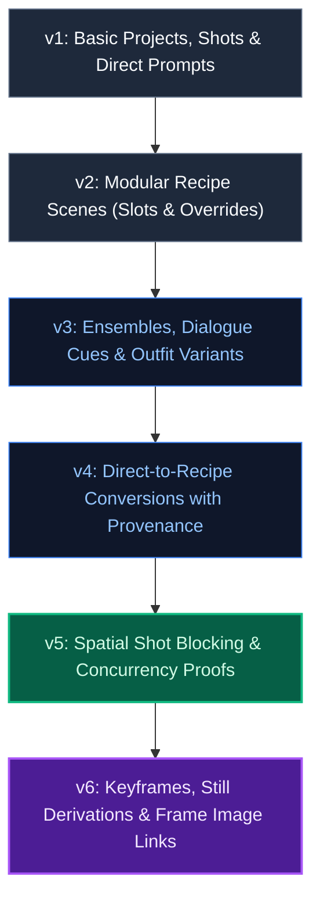
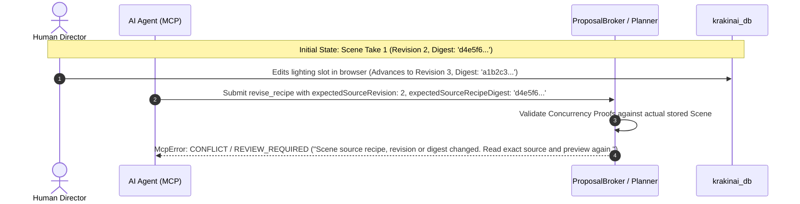

# Chapter 9: Change-Set Contracts (v1–v6) & Security Model

> *Part IV: Detailed Technical Documentation*  
> Previous: [Chapter 8: System Architecture, Data Model & Storage](./08-technical-architecture-and-storage.md) | Next: [Chapter 10: Complete MCP Protocol, Bridge Architecture & 37-Tool Reference](./10-technical-mcp-reference.md)

---

## 1. Overview: The Immutable Change-Set Contract

In KRAKINAI, all mutations proposed by external entities—whether from a manual Stage B JSON file or an autonomous AI agent operating over the Model Context Protocol (MCP)—are encapsulated in a formal data structure called a **ChangeSet**.

A ChangeSet is:
1. **Atomic**: Either all approved operations apply in a single IndexedDB transaction, or none apply.
2. **Typed & Versioned**: Adheres to strict, backwards-compatible JSON Schemas (`v1` through `v6`).
3. **Cryptographically Sealed**: Carries a canonical SHA-256 `packageDigest`.
4. **Concurrency-Protected**: Uses exact parent revision numbers, head IDs, and source digests to prevent stale overwrites.
5. **Audited**: Recorded permanently in the browser's **Import Ledger** upon application.



---

## 2. Schema Evolution: From Direct Prompts (v1) to Keyframe Plans (v6)

### Schema Version 1: `krakinai.change-set.v1`
- Introduced the core transactional envelope: `schema`, `changeSetId`, `source`, `title`, `description`, `operations`.
- Supported basic `project.create`, `project.update`, `shot.create`, `shot.update`, `shot.reorder`, `asset.propose`, and legacy `scene.create_direct_prompt` operations.

### Schema Version 2: `krakinai.change-set.v2`
- Introduced structured recipe authoring.
- Added operations:
  - `scene.create_recipe`: Builds a new modular recipe from slots.
  - `scene.revise_recipe`: Adds an immutable revision to an existing recipe lineage (`expectedHeadId`).
  - `scene.create_recipe_take`: Branches an alternate creative take on the same storyboard shot.
- Supported camera composition, lighting, style, and slot text overrides.

### Schema Version 3: `krakinai.change-set.v3`
- Introduced multi-actor visual storytelling.
- Added support for:
  - `variant.propose` and `variant.review_candidate`: Character-owned child Outfit variants.
  - Multi-character **Ensemble patches** (`ensemble.participantUpserts`, `primaryParticipantId`).
  - Timed **Dialogue Cues** (`dialogueCues`) with `startSeconds` and `endSeconds`.
  - V1 and V2 Performance Studio direction.

### Schema Version 4: `krakinai.change-set.v4`
- Introduced guided conversion of legacy raw-text prompts into modular recipes.
- Added operation:
  - `scene.convert_direct_to_recipe`: Converts a direct prompt scene into a recipe take while maintaining a cryptographic link to the original raw prompt (`conversion.sourceTextSha256`).

### Schema Version 5: `krakinai.change-set.v5`
- Introduced 3D/2D spatial choreography and multi-token concurrency proofs.
- Added support for:
  - `scene.create_recipe` / `revise_recipe` with embedded `BlockingPatchV1`.
  - Three-phase spatial staging: `Start -> Action -> End`.
  - Screen zones, depth planes, postures, landmarks, and props.
  - Mandatory concurrency tokens: `expectedSourceRevision`, `expectedSourceRecipeDigest`, and `expectedBlockingDigest`.

### Schema Version 6: `krakinai.change-set.v6`
- Introduced keyframe planning, still-frame prompt derivation, and media association.
- Added operations:
  - `frame_image.link`: Binds an externally generated image from the Media Vault to a specific keyframe.
  - `frame_image.clear`: Unbinds an associated image.
- Added support for:
  - `KeyframePatchV1` on scene operations (`frames` with `start`, `middle`, `end`, `custom` roles).
  - Mandatory token: `expectedKeyframeDigest`.

---

## 3. Comprehensive Operation Type Catalog

Every item in a ChangeSet's `operations` array is a strictly validated `ChangeOperation`. Below is the complete catalog:

| Operation Type | Minimum Schema | Required Parameters | Purpose |
| :--- | :---: | :--- | :--- |
| **`project.create`** | `v1` | `clientRef`, `name` | Creates a new storyboard project container. |
| **`project.update`** | `v1` | `project: { id, expectedRevision }` | Modifies project title, description, or notes. |
| **`shot.create`** | `v1` | `project`, `clientRef`, `code`, `title` | Adds a new storyboard shot to a project. |
| **`shot.update`** | `v1` | `project`, `shot: { id }` | Updates shot code, title, duration, or notes. |
| **`shot.reorder`** | `v1` | `project`, `shots: RecordTarget[]` | Reorders all storyboard shots in a project. |
| **`shot.attach_take`** | `v1` | `project`, `shot`, `scene` | Attaches a scene take to a shot's take list. |
| **`shot.select_take`** | `v1` | `project`, `shot`, `scene`, `expectedSelectedSceneId` | Changes the preferred take for a shot. |
| **`shot.set_status`** | `v1` | `project`, `shot`, `status`, `expectedStatus` | Advances shot production status (`planned` $\to$ `final`). |
| **`asset.propose`** | `v1` | `clientRef`, `kind`, `title`, `promptText`, `tags` | Proposes a new reusable asset candidate. |
| **`asset.review_candidate`** | `v1` | `candidateId`, `expectedRevision` | Records human review decision on an asset candidate. |
| **`variant.propose`** | `v3` | `clientRef`, `parentCharacterId`, `expectedParentRevision`, `title`, `promptText`, `tags` | Proposes a character-owned Outfit variant. |
| **`variant.review_candidate`** | `v3` | `candidateId`, `expectedRevision` | Records human review decision on an Outfit variant. |
| **`scene.create_recipe`** | `v2` | `clientRef`, `project`, `shot`, `title`, `shotType`, `settings` | Creates a new modular recipe scene take. |
| **`scene.revise_recipe`** | `v2` | `clientRef`, `project`, `shot`, `sceneId`, `expectedHeadId` | Adds an immutable revision to an existing recipe. |
| **`scene.create_recipe_take`**| `v2` | `clientRef`, `project`, `shot`, `sceneId`, `expectedHeadId` | Creates a parallel sibling take on an existing shot. |
| **`scene.convert_direct_to_recipe`** | `v4` | `clientRef`, `project`, `shot`, `sceneId`, `expectedHeadId`, `conversion` | Converts legacy direct prompt into a recipe take. |
| **`frame_image.link`** | `v6` | `project`, `shot`, `scene`, `frameId`, `mediaId`, `expectedFrameDigest` | Links an image file to a specific keyframe beat. |
| **`frame_image.clear`** | `v6` | `project`, `shot`, `scene`, `frameId`, `expectedFrameDigest` | Unlinks media from a keyframe. |

---

## 4. Concurrency Proofs & Anti-Overwrite Safeguards

In multi-user or AI-assisted workflows, two agents (or an agent and a human) might try to modify the same scene or shot simultaneously. KRAKINAI prevents lost updates through **explicit concurrency proofs**:



### Concurrency Tokens Used by KRAKINAI
1. **`expectedRevision`**: Integer revision counter on Projects and Assets. If another process updated the project in the interim, the operation rejects.
2. **`expectedHeadId`**: Ensures scene revisions attach to the exact current lineage head.
3. **`expectedSourceRevision`**: Pinned revision of the parent scene being revised or converted.
4. **`expectedSourceRecipeDigest`**: SHA-256 hash of the parent scene's exact recipe content.
5. **`expectedBlockingDigest`**: SHA-256 hash of the parent scene's existing blocking data (`NULL_BLOCKING_DIGEST` if previously unblocked).
6. **`expectedKeyframeDigest`**: SHA-256 hash of the parent scene's keyframe plan.
7. **`expectedAssociationRevision`**: Version counter on frame-to-media bindings.

---

## 5. The Import Ledger & Cryptographic Confirmation Receipts

Once a human clicks **Apply Approved Changes**, KRAKINAI executes an atomic write transaction. As part of that transaction, an immutable **Import Receipt** is stamped into the user's `importLedger` in `preferences`:

### Anatomy of an Import Receipt
```json
{
  "receiptId": "rcpt-8f92a10b-4e12-4c55-b1a9-92b0c3d4e5f6",
  "changeSetId": "cs-episode-1-cold-open",
  "packageDigest": "e3b0c44298fc1c149afbf4c8996fb92427ae41e4649b934ca495991b7852b855",
  "approvedDigest": "74234e98afe7498fb5daf1f36ac2d78acc339464f950703b8c019892f982b90b",
  "appliedAt": "2026-11-08T02:30:00.000Z",
  "appliedBy": "human_reviewer",
  "operationsApplied": 7,
  "allocatedRecords": {
    "proj-ep1": "col-a1b2",
    "shot-s01": "shot-c3d4",
    "scene-s01": "sc-e5f6"
  }
}
```

### Idempotent Replay Protection
If an AI agent accidentally re-submits a proposal that has already been applied, KRAKINAI inspects the `importLedger`. If a matching `changeSetId` and `packageDigest` exists, KRAKINAI immediately returns the confirmed receipt via `krakinai_get_import_receipt` without re-executing any database writes.

---

## 6. Browser Security Invariants

KRAKINAI enforces four non-negotiable security rules:

1. **The `event.isTrusted` Invariant**:
   - Web browsers mark synthetic DOM events generated by JavaScript (`element.click()`) with `event.isTrusted = false`.
   - Only physical user input (real mouse clicks, touchscreen taps, or keyboard presses) carry `event.isTrusted = true`.
   - `ProposalBroker.applyFromUserEvent()` explicitly asserts `event.isTrusted`. **No script, extension, or MCP bridge can spoof human consent.**
2. **Zero Direct Unreviewed Writes**:
   - The MCP bridge process and HTTP relay have zero database drivers. They can only communicate with the browser's `ProposalBroker`, which only writes to the staging inbox `krakinai_review_inbox_db`.
3. **Loopback Isolation**:
   - The desktop relay binds strictly to `127.0.0.1`. It rejects any network connections originating from external LAN or WAN IP addresses.
4. **Scope Partitioning**:
   - If an agent has not been granted `allowBlockingProposals` or `allowKeyframeProposals`, any staged operations requiring those schemas are rejected with `PERMISSION_DENIED` before touching the inbox.

---

> **Next Up:** Continue to [Chapter 10: Complete MCP Protocol, Bridge Architecture & 37-Tool Reference](./10-technical-mcp-reference.md) for the exhaustive specification of all 37 MCP tools.
