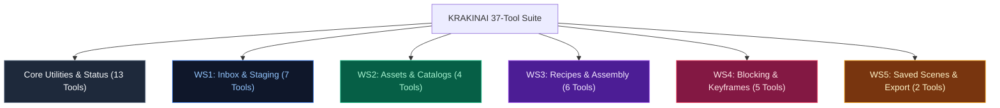

# Chapter 10: Complete MCP Protocol, Bridge Architecture & 37-Tool Reference

> *Part IV: Detailed Technical Documentation*  
> Previous: [Chapter 9: Change-Set Contracts (v1–v6) & Security Model](./09-technical-changeset-and-security.md) | Next: [README (Cover & Table of Contents)](./README.md)

---

## 1. Overview: The Model Context Protocol in KRAKINAI

The **Model Context Protocol (MCP)** is an open industry standard that enables AI assistants (such as Claude Desktop, OpenAI Codex, Antigravity, or Cursor) to securely interface with local development tools and specialized desktop applications.

KRAKINAI provides a state-of-the-art **3-tier Local MCP Bridge** that allows external AI assistants to discover project context, inspect asset catalogs, and incrementally stage multi-shot storyboards while guaranteeing that **zero unconfirmed writes** can touch your local IndexedDB library.

This chapter details:
1. The 3-tier bridge architecture and loopback transport security.
2. HMAC pairing challenge-response and session epoch rotation.
3. Schema discovery factoring and frame budget management.
4. Error handling and standard error codes.
5. **The Complete 37-Tool Reference Catalog** (13 core tools + 24 granular inspection & staging tools).

```mermaid
graph LR
    subgraph Client["MCP Host Client"]
        Agent["AI Assistant\n(Claude / Codex / Antigravity)"]
    end

    subgraph Bridge["Tier 3 & 2: Local Bridge Process"]
        Stdio["Stdio MCP Adapter\n(bridge/src/stdioAdapter.ts)"]
        Relay["Loopback HTTP Relay\n(127.0.0.1:port)\nHMAC Proof & Epoch Rotation"]
    end

    subgraph Browser["Tier 1: Browser Web App"]
        Broker["ProposalBroker\n(src/connections/proposalBroker.ts)\nMcpScope & Review Authority"]
        Inbox["ProposalReviewInbox\n(krakinai_review_inbox_db)"]
        DB["Main Library Vault\n(krakinai_db)"]
    end

    Agent <==>|Standard MCP Stdio| Stdio
    Stdio <==>|Loopback IPC| Relay
    Relay <==>|Loopback HTTP + HMAC Proof| Broker
    Broker <==>|Read / Upsert Drafts| Inbox
    Broker -.->|Confirmed Human Action Only\n(event.isTrusted)| DB
```

---

## 2. The 3-Tier Bridge Architecture

KRAKINAI divides the MCP transport into three isolated tiers:

### Tier 1: The Browser `ProposalBroker`
- **Location**: Runs directly inside the web browser (`src/connections/proposalBroker.ts`).
- **Role**: The ultimate application authority. Holds active session state, enforces `McpScope` permission gates, coordinates cross-tab Web Locks, and computes cryptographic package digests.
- **Security Boundary**: Does not expose any direct database mutators to the network.

### Tier 2: The Authenticated Loopback HTTP Relay
- **Location**: Binds strictly to `127.0.0.1:<port>` on the local machine.
- **Pairing Handshake**:
  1. The browser emits a cryptographic pairing challenge upon user activation.
  2. The local bridge computes an HMAC response using the machine's local pairing secret.
  3. The browser validates the proof and establishes an authenticated session token.
- **Session Lifecycles & Epoch Rotation**:
  - `sessionMs = 3,600,000` (1 hour hard session expiration).
  - `idleMs = 900,000` (15 minutes inactivity timeout).
  - Every time permissions (`McpScope`) are modified by the human in the browser, `scope.epoch` increments. Any pending requests or cached tokens from the prior epoch immediately reject with `PERMISSION_DENIED`.

### Tier 3: The Stdio Adapter Process
- **Location**: Node.js CLI process (`bridge/dist/index.js`).
- **Role**: Translates standard MCP JSON-RPC requests from the AI host client over `stdin`/`stdout` into authenticated HTTP loopback commands to Tier 2.

---

## 3. Schema Discovery Factoring (`MCP_LIMITS.frame`)

The Model Context Protocol requires server adapters to describe all available tools during the `tools/list` handshake. When exposing 37 granular tools—many with deep JSON schemas for shot blocking, dialogue cues, and keyframe plans—the serialized schema payload can easily exceed the client's frame limit.

KRAKINAI's bridge implements **Schema Discovery Factoring** (`bridge/src/schemaDiscovery.ts`):
- Common subtrees (such as `RECORD_TARGET_SCHEMA`, `settings`, `media`, and `idSchema`) are factored into shared `$defs`.
- The factored discovery schema produces **504,165 bytes**, safely under KRAKINAI's strict frame ceiling of **1,310,720 bytes** (`MCP_LIMITS.frame`).
- Zero validation strength is lost: argument validators in `mcpProtocol.ts` continue enforcing strict runtime types (`string`, `number`, `integer`, `boolean`, `array`, `object`).

---

## 4. Standard Protocol Error Codes

When an MCP command cannot be completed, KRAKINAI throws an `McpError` with a standard machine-readable code:

| Error Code | Meaning | What Triggers It |
| :--- | :--- | :--- |
| **`INVALID_REQUEST`** | Malformed parameters | Missing required argument, unknown field, string length violation, or invalid enum value. |
| **`PERMISSION_DENIED`** | Scope restriction | Attempting to access an asset, scene, or project not checked in `McpScope`, or calling a staging tool when `allowProposals` is false. |
| **`NOT_FOUND`** | Entity missing | Referencing a `sceneId`, `projectId`, or `sceneClientRef` that does not exist in storage or the staged draft. |
| **`CONFLICT`** | State collision | Staging changes on a proposal whose disposition is already `applying` or `applied`, or digest mismatch on committed receipts. |
| **`QUEUE_FULL`** | Inbox capacity reached | Staging a new proposal when the Review Inbox already contains 8 unapplied packages (`MCP_LIMITS.proposals = 8`). |
| **`REVIEW_REQUIRED`** | Human consent needed | Attempting to apply a proposal without a confirmed, matching `approvedDigest` or before resolving blocking preflight findings. |
| **`CAPABILITY_REQUIRED`** | Version mismatch | Attempting to stage v5 blocking without `blocking-v5` capabilities, or v6 keyframes without `keyframes-v6` capabilities. |
| **`DISCONNECTED`** | Session terminated | The browser tab was closed, the 15-minute idle timer expired, or the user clicked Disconnect. |
| **`PROPOSAL_EXPIRED`** | Time window elapsed | The proposal's 24-hour review window expired (`REVIEW_WINDOW_MS = 86400000`). |
| **`PAYLOAD_TOO_LARGE`** | Byte budget exceeded | ChangeSet exceeds 1 MB (`MCP_LIMITS.package = 1048576`) or result exceeds 512 KB (`MCP_LIMITS.result = 524288`). |
| **`UNKNOWN_TOOL`** | Unrecognized tool | The requested tool name is not member of `MCP_TOOL_NAMES`. |

---

## 5. The Complete 37-Tool API Catalog

KRAKINAI provides **37 official MCP tools** organized into 5 functional workstreams and core utilities:



---

### Group 1: Core System & Status Tools (2 Tools)

#### `krakinai_connection_status`
- **Purpose**: Returns the active connection health, session ID, and granted `McpScope`.
- **Arguments**: None.
- **Returns**: `{ connected: boolean, sessionId?: string, scope: McpScope, capabilities: string[] }`.

#### `krakinai_get_shot_types`
- **Purpose**: Returns the four context-aware shot types and their descriptions.
- **Arguments**: None.
- **Returns**: `{ shotTypes: Array<{ type: string, label: string, description: string }> }`.

---

### Group 2: Core Projects & Storyboards (3 Tools)

#### `krakinai_list_projects`
- **Purpose**: Returns a paginated list of authorized projects.
- **Arguments**: `cursor?: string`, `limit?: integer (1-50)`.
- **Returns**: `{ projects: Array<{ id: string, name: string, description: string, shotCount: number }>, nextCursor?: string }`.

#### `krakinai_get_project`
- **Purpose**: Returns full details for a single project including shot codes and planned durations.
- **Arguments**: `projectId: string` (required).
- **Scope**: `projectId` must be in `authorizedProjectIds`.
- **Returns**: Project metadata, shots array, and revision counter.

#### `krakinai_get_storyboard`
- **Purpose**: Returns the complete sequential storyboard timeline for a project.
- **Arguments**: `projectId: string` (required), `projection?: 'metadata' | 'keyframes'`, `cursor?: string`, `limit?: integer`.
- **Returns**: Ordered shots with attached preferred takes, production statuses, and keyframe plans.

---

### Group 3: Core Scenes & History (2 Tools)

#### `krakinai_get_scene`
- **Purpose**: Returns details of a specific saved scene take.
- **Arguments**: `sceneId: string` (required), `projection?: 'metadata' | 'keyframes'`.
- **Scope**: `sceneId` must be in `authorizedSceneIds`. (Full prompt text is redacted unless `sceneId` is in `fullPromptSceneIds`).
- **Returns**: Scene title, shot type, slots, dialogue, camera composition, and outputs.

#### `krakinai_get_scene_history`
- **Purpose**: Returns the complete immutable revision lineage for a scene.
- **Arguments**: `sceneId: string` (required), `cursor?: string`, `limit?: integer`.
- **Returns**: Array of historical revisions sharing the same `headId` with timestamps and author notes.

---

### Group 4: Core Assets & Prompts (2 Tools)

#### `krakinai_search_assets`
- **Purpose**: Searches authorized library assets by keyword, category, or kind.
- **Arguments**: `query?: string`, `category?: string`, `kind?: 'asset' | 'variant' | 'template'`, `cursor?: string`, `limit?: integer`.
- **Returns**: Matching assets with titles, categories, and tags (prompt text redacted unless `includeAssetText` is true).

#### `krakinai_get_generation_prompt`
- **Purpose**: Returns the compiled prompt for an authorized scene or specific keyframe.
- **Arguments**: `sceneId: string` (required), `target?: { kind: 'image', keyframeId: string, mode: 'full' | 'compact' }`.
- **Scope**: Requires `fullPromptSceneIds` permission.
- **Returns**: Compiled prompt text tailored for external generation.

---

### Group 5: Core Monolithic ChangeSets & Receipts (4 Tools)

#### `krakinai_preview_change_set`
- **Purpose**: Runs dry-run validation over a full ChangeSet payload without modifying storage.
- **Arguments**: `changeSet: ChangeSet` (required), `projection?: FrameMcpProjection`.
- **Returns**: `packageDigest`, `batchChecks`, `requestedOperations`, and schema findings.

#### `krakinai_submit_change_set`
- **Purpose**: Submits a full ChangeSet into the Proposal Review Inbox.
- **Arguments**: `changeSet: ChangeSet` (required).
- **Scope**: Requires `allowProposals: true`.
- **Returns**: `proposalId`, `status: 'review_required'`, `packageDigest`, and `expiresAt`.

#### `krakinai_get_proposal_status`
- **Purpose**: Checks the review disposition and feedback of an admitted proposal.
- **Arguments**: `proposalId: string` (required), `projection?: FrameMcpProjection`.
- **Returns**: Status (`review_required`, `approved`, `rejected`, `applied`, `expired`), reviewer feedback, and batch checks.

#### `krakinai_get_import_receipt`
- **Purpose**: Retrieves the permanent cryptographic confirmation receipt for an applied change-set.
- **Arguments**: `changeSetId: string` (required), `packageDigest: string` (required).
- **Returns**: Immutable receipt details including applied timestamps and record IDs.

---

### Group 6: Workstream 1 — Inbox & Project/Shot Staging (7 Tools)

#### `krakinai_list_proposals`
- **Purpose**: Lists all proposals currently residing in the Review Inbox.
- **Arguments**: None.
- **Scope**: Requires `allowProposals: true`.
- **Returns**: `{ items: Array<{ proposalId: string, changeSetId: string, title: string, status: string, operationCount: number, blockingFindingCount: number, expiresAt: number }> }`.

#### `krakinai_discard_proposal`
- **Purpose**: Discards an unapplied proposal to free up inbox capacity (`limit = 8`).
- **Arguments**: `proposalId: string` (required).
- **Returns**: `{ discarded: true, proposalId: string }`.

#### `krakinai_stage_storyboard_batch`
- **Purpose**: Atomically stages an entire multi-shot storyboard package into a draft proposal in a single tool call, including project container, candidate assets, outfit variants, shots, and composite scene recipes.
- **Arguments**:
  - `changeSetId: string` (required): Proposal identifier.
  - `title?: string`: Proposal title.
  - `description?: string`: Multi-paragraph proposal description.
  - `project?: object`: Project creation or update payload (`clientRef`, `name`, `description`, `planningNotes`).
  - `assets?: Array<object>`: List of candidate assets (`clientRef`, `kind`, `title`, `promptText`, `tags`).
  - `variants?: Array<object>`: List of outfit variants (`clientRef`, `parentCharacterId`, `title`, `promptText`).
  - `shots?: Array<object>`: List of shots to create (`clientRef`, `code`, `title`, `plannedShotType`, `plannedDurationSeconds`).
  - `scenes?: Array<object>`: List of composite scene recipes (`clientRef`, `shot`, `title`, `shotType`, `settings`, `assetRefs`, `ensemble`, `cameraComposition`, `sceneInstructions`, `avoidText`, `blocking`, `keyframes`).
- **Returns**: `{ proposalId, changeSetId, operationCount, stagedCounts: { assets, variants, projects, shots, scenes }, batchChecks }`.

#### `krakinai_stage_project`
- **Purpose**: Stages a `project.create` or `project.update` operation into a draft proposal.
- **Arguments**: `changeSetId: string`, `name: string`, `title?: string`, `description?: string`, `planningNotes?: string`, `projectId?: string`, `expectedRevision?: integer`.
- **Returns**: `{ proposalId, changeSetId, operationCount, stagedOperationId, batchChecks }`.

#### `krakinai_stage_shot`
- **Purpose**: Stages a `shot.create` or `shot.update` operation.
- **Arguments**: `changeSetId: string`, `project: { id } | { ref }`, `code: string`, `title: string`, `plannedShotType?: string`, `plannedDurationSeconds?: number`, `continuityNotes?: string`, `shotId?: string`.
- **Returns**: Proposal status and staged operation ID.

#### `krakinai_stage_shot_order`
- **Purpose**: Stages a `shot.reorder` operation to rearrange shots.
- **Arguments**: `changeSetId: string`, `project: { id } | { ref }`, `shots: Array<{ id } | { ref }>`.
- **Returns**: Proposal status and staged operation ID.

#### `krakinai_stage_shot_status`
- **Purpose**: Stages a `shot.set_status` or `shot.select_take` operation.
- **Arguments**: `changeSetId: string`, `project`, `shot`, `status?: string`, `expectedStatus?: string`, `selectedScene?: RecordTarget`, `expectedSelectedSceneId?: string`.
- **Returns**: Proposal status and staged operation ID.

---

### Group 7: Workstream 2 — Assets, Variants & Presets (4 Tools)

#### `krakinai_get_asset`
- **Purpose**: Returns complete authorized details for an individual asset, including linked Outfit variants.
- **Arguments**: `id: string` (required).
- **Scope**: Redacts prompt text unless `includeAssetText` is true; redacts Identity Anchor unless `includeCharacterIdentity` is true.
- **Returns**: Asset metadata, prompt text, identity anchor, and `outfitVariants` array.

#### `krakinai_list_catalog_presets`
- **Purpose**: Read-only lookup of KRAKINAI's built-in catalogs.
- **Arguments**: `catalog: 'cinematography' | 'performance' | 'shot_types'` (required).
- **Returns**: Structured lists of shot sizes, angles, movements, emotions, vocal fields, or shot type rules.

#### `krakinai_stage_asset_candidate`
- **Purpose**: Stages an `asset.propose` operation for a new reusable asset candidate.
- **Arguments**: `changeSetId: string`, `clientRef: string`, `kind: string`, `title: string`, `promptText: string`, `description?: string`, `tags?: string[]`, `notes?: string`.
- **Returns**: Proposal status and staged operation ID.

#### `krakinai_stage_outfit_variant`
- **Purpose**: Stages a `variant.propose` operation for a character-owned Outfit variant.
- **Arguments**: `changeSetId: string`, `clientRef: string`, `parentCharacterId: string`, `expectedParentRevision: integer`, `title: string`, `promptText: string`, `tags?: string[]`, `notes?: string`.
- **Returns**: Proposal status and staged operation ID.

---

### Group 8: Workstream 3 — Scene Recipes & Assembly (6 Tools)

#### `krakinai_stage_scene_recipe`
- **Purpose**: Stages a modular `scene.create_recipe`, `scene.revise_recipe`, or `scene.create_recipe_take` operation.
- **Arguments**: `changeSetId: string`, `clientRef: string`, `project`, `shot`, `title: string`, `shotType?: string`, `settings?: object`, `slots?: object`, `sceneInstructions?: string`, `avoidText?: string`, `mode?: 'create' | 'revise' | 'take'`.
- **Returns**: Proposal status and staged operation ID.

#### `krakinai_stage_scene_ensemble`
- **Purpose**: Sets or patches the multi-actor `ensemble` block on an already-staged scene recipe.
- **Arguments**: `changeSetId: string`, `sceneClientRef: string`, `participants: Array<object>`, `primaryParticipantId?: string`, `removeParticipantIds?: string[]`.
- **Returns**: Proposal status and staged operation ID.

#### `krakinai_stage_scene_dialogue`
- **Purpose**: Sets single-speaker `dialogue` or multi-speaker `dialogueCues` with timing and performance direction.
- **Arguments**: `changeSetId: string`, `sceneClientRef: string`, `dialogue?: object`, `dialogueCues?: Array<object>`.
- **Returns**: Proposal status and staged operation ID.

#### `krakinai_stage_camera_composition`
- **Purpose**: Sets structured camera framing, angles, lenses, and movement on a staged recipe.
- **Arguments**: `changeSetId: string`, `sceneClientRef: string`, `cameraComposition: object`.
- **Returns**: Proposal status and staged operation ID.

#### `krakinai_stage_direct_to_recipe`
- **Purpose**: Stages a `scene.convert_direct_to_recipe` conversion operation on an existing direct prompt take.
- **Arguments**: `changeSetId: string`, `clientRef: string`, `project`, `shot`, `sceneId: string`, `expectedHeadId: string`, `title: string`, `conversion: object`.
- **Returns**: Proposal status and staged operation ID (promotes package to `v4`).

#### `krakinai_preview_scene_assembly`
- **Purpose**: Compiles a prompt assembly preview and runs preflight rules on a saved or staged scene.
- **Arguments**: `sceneId?: string`, `changeSetId?: string`, `sceneClientRef?: string`.
- **Returns**: Assembled prompt text (if disclosed), preflight findings, and validation status.

---

### Group 9: Workstream 4 — Continuity, Blocking & Keyframes (5 Tools)

#### `krakinai_get_project_continuity`
- **Purpose**: Analyzes project continuity, returning the Cast Bible matrix, wardrobe timeline, and transition warnings.
- **Arguments**: `projectId: string` (required).
- **Returns**: `{ projectId, cast, transitions, summary }`.

#### `krakinai_check_spatial_continuity`
- **Purpose**: Evaluates 180-degree rule, screen direction jumps, and zone flips across storyboard cuts (including staged blocking).
- **Arguments**: `projectId: string` (required), `changeSetId?: string`.
- **Returns**: `{ projectId, findings: Array<object>, comparisons: Array<object> }`.

#### `krakinai_stage_scene_blocking`
- **Purpose**: Stages v5 `blocking` choreography (`Start -> Action -> End`, landmarks, props) onto a recipe.
- **Arguments**: `changeSetId: string`, `sceneClientRef: string`, `blocking: object`, `expectedSourceTokens?: object`.
- **Capability**: Requires `allowBlockingProposals: true` and `blocking-v5` pairing.
- **Returns**: Proposal status and staged operation ID (promotes package to `v5`).

#### `krakinai_stage_keyframe_plan`
- **Purpose**: Stages a v6 `keyframePlan` (start/end frame visual beats) onto a recipe.
- **Arguments**: `changeSetId: string`, `sceneClientRef: string`, `keyframePlan: object`, `expectedSourceTokens?: object`.
- **Capability**: Requires `allowKeyframeProposals: true` and `keyframes-v6` pairing.
- **Returns**: Proposal status and staged operation ID (promotes package to `v6`).

#### `krakinai_stage_frame_image`
- **Purpose**: Stages a `frame_image.link` or `frame_image.clear` operation binding an image to a keyframe.
- **Arguments**: `changeSetId: string`, `project`, `shot`, `scene`, `frameId: string`, `mediaId?: string`, `expectedFrameDigest?: string`, `expectedAssociationRevision?: integer`.
- **Capability**: Requires `allowKeyframeProposals: true` and `keyframes-v6` pairing.
- **Returns**: Proposal status and staged operation ID (promotes package to `v6`).

---

### Group 10: Workstream 5 — Saved Scenes & Bulk Exports (2 Tools)

#### `krakinai_list_saved_scenes`
- **Purpose**: Searches and filters saved scene takes across active and archived states.
- **Arguments**: `query?: string`, `archiveFilter?: 'active' | 'archived' | 'all'`, `shotType?: string`, `reviewStatus?: string`, `cursor?: string`, `limit?: integer`.
- **Returns**: `{ items: Array<{ id, headId, title, shotType, reviewStatus, archivedAt }>, total, nextCursor }`.

#### `krakinai_export_scene_prompts`
- **Purpose**: Formats and returns the combined full prompts for an array of authorized scene IDs.
- **Arguments**: `sceneIds: string[]` (required).
- **Scope**: Every ID in `sceneIds` must have `fullPromptSceneIds` permission.
- **Returns**: `{ text: string, sceneCount: number }`.

---

> **End of Book:** You have completed the KRAKINAI Official Manual! Return to the [Table of Contents](./README.md) or compile this manual to PDF using `npm run docs:manual`.
