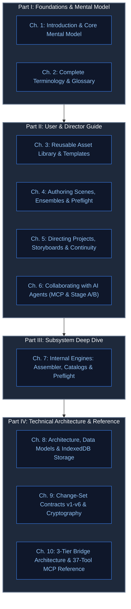

# KRAKINAI: The Complete Manual & Architecture Guide

> **Official Comprehensive Handbook & Technical Reference**  
> *Authoring Local-First, Reusable, Human-Governed AI Video Storyboards*

---

## Welcome to KRAKINAI

**KRAKINAI** is a local-first creative production studio and prompt compiler designed for high-cohesion, multi-shot AI video production. Instead of treating AI video generation as a series of disconnected, ad-hoc text prompts, KRAKINAI structures narrative video into **modular, reusable cinematic assets, deterministic recipes, spatial blocking plans, and continuous multi-shot storyboards**.

KRAKINAI operates on a strict **human-in-the-loop security and immutability architecture**:
- AI agents and collaborative tools can propose rich multi-shot storyboards through the **Model Context Protocol (MCP)** or manual **Stage A/B packages**, but **zero unconfirmed writes** can touch your local IndexedDB library.
- Saved scenes are **immutable**, forming verifiable revision lineages.
- Prompts assemble **deterministically** across three output tiers (Full Prompts, Structured Component Breakdowns, and Compact Mobile Formats).
- Story continuity—including character cast consistency, wardrobe progressions across shots, and 3D camera/actor blocking—is verified before generation begins.

Whether you are a solo creative director crafting cinematic shorts, a visual storyteller directing episodic series, an autonomous AI coding assistant pair-programming via MCP, or a software engineer extending the KRAKINAI platform, this manual provides the complete, authoritative guide to every concept, interface, algorithm, and wire protocol inside the system.

---

## How to Read This Manual

This handbook is organized into four logical parts, tailored to different workflows:



### By Reader Role

* **Prompt Authors & Content Creators**: Start with [Chapter 1: Introduction & Mental Model](./01-introduction-and-mental-model.md) to understand the *Recipe over Raw Text* philosophy, then dive into [Chapter 3: Library & Templates](./03-user-guide-library-and-templates.md) and [Chapter 4: Scene Authoring](./04-user-guide-scene-authoring.md).
* **Directors & Showrunners**: Read [Chapter 2: Glossary](./02-terminologies-and-glossary.md), [Chapter 4: Scene Authoring](./04-user-guide-scene-authoring.md) (specifically Ensemble, Performance Studio, and Shot Blocking), and [Chapter 5: Projects, Storyboards & Continuity](./05-user-guide-projects-and-continuity.md) to master episodic cast management and timeline transitions.
* **AI Agents & MCP Integrators**: Study [Chapter 6: Collaborating with AI Agents](./06-user-guide-ai-collaboration.md), [Chapter 9: Change-Set Contracts](./09-technical-changeset-and-security.md), and [Chapter 10: Complete 37-Tool MCP Reference](./10-technical-mcp-reference.md).
* **Core Developers & Contributors**: Read [Chapter 7: Internal Engines](./07-inside-krakinai-engines.md), [Chapter 8: Architecture & Storage](./08-technical-architecture-and-storage.md), and [Chapter 9: Change-Set Contracts](./09-technical-changeset-and-security.md).

---

## Master Table of Contents

### Part I: Foundations & Mental Model
* **[Chapter 1: Introduction & Core Mental Model](./01-introduction-and-mental-model.md)**
  * The Problem with Raw-Text AI Prompts
  * The Four Core Architectural Pillars
  * The KRAKINAI Workspace Navigation Map (8 Primary Views)
  * End-to-End Production Lifecycle
* **[Chapter 2: Complete Terminology & Glossary](./02-terminologies-and-glossary.md)**
  * Library & Asset Entities
  * Scene Authoring, Slots & Revisions
  * Ensemble, Dialogue Cues & Performance Studio
  * Cinematography, Lens & Camera Parameters
  * Shot Blocking (v5) & Spatial Staging
  * Keyframes & Image Prompt Studio (v6)
  * Projects, Storyboards, Takes & Continuity
  * AI Proposal Review, Digested Change-Sets & Local MCP Governance

### Part II: How to Use KRAKINAI (User & Director Guide)
* **[Chapter 3: Building Your Reusable Asset Library & Templates](./03-user-guide-library-and-templates.md)**
  * Managing Prompt Assets across the 7 Categories
  * Locking Character Identity Anchors (Immutable Traits & Prohibited Drift)
  * Character-Owned Outfit Variants
  * Attaching Media Links: Reference Files vs Generative Samples
  * Authoring and Reusing Scene Templates
* **[Chapter 4: Authoring Scenes — Recipe Builder, Ensemble, Camera & Preflight](./04-user-guide-scene-authoring.md)**
  * Context-Aware Shot Types and Dynamic Slot Rules
  * Single-Character vs Multi-Character Ensemble Authoring
  * Dialogue Cues & The Performance Studio (Emotions, Voice, Pacing, Gestures)
  * Cinematography Studio (Presets, Focal Length, Depth-of-Field, Compound Moves)
  * Spatial Shot Blocking (v5): Landmarks, Props, and Screen Zones
  * Keyframes & Image Prompt Studio (v6): Start/End Frames for Google Flow
  * Preflight Rule Checks (`P000`–`P008`) and Auto-Validation
  * Managing Saved Scenes: Revisions, Soft-Archive, Bulk Actions & Prompt Exports
* **[Chapter 5: Directing Projects, Storyboards & Continuity](./05-user-guide-projects-and-continuity.md)**
  * Creating Projects and Configuring Narrative Sequences
  * Shot Codes, Durations, and Reordering
  * Attaching Multiple Scene Takes per Shot & Setting Preferred Takes
  * Production Status Tracking (`planned` $\to$ `prompt_ready` $\to$ `generated` $\to$ `reviewed` $\to$ `final`)
  * The Continuity Workspace: Cast Bible Matrix & Wardrobe Timelines
  * Spatial Continuity Review: Detecting Screen Direction & Blocking Flips
* **[Chapter 6: Collaborating with AI Agents (MCP & Stage A/B Workflows)](./06-user-guide-ai-collaboration.md)**
  * Workflow 1: Manual Stage A Context Export & Stage B Change-Set Import
  * Workflow 2: Live Local MCP Pairing via the KRAKINAI Desktop Bridge
  * Permission Governance: Granular `McpScope` Grants & Capability Pairing
  * Incremental Storyboard Authoring via `krakinai_stage_*` Tools
  * The Incoming Proposals Review Inbox: Diff Inspection, Candidate Reuse & Approvals

### Part III: What's Inside KRAKINAI (Subsystem Deep Dive)
* **[Chapter 7: Internal Engines — Prompt Assembler, Catalogs & Validators](./07-inside-krakinai-engines.md)**
  * The Deterministic Prompt Assembly Pipeline (`SCENE_COMPONENT_ORDER`)
  * Multi-Tier Output Modes: Full, Structured, and Compact Formats
  * Negative & Avoid Text Hierarchies
  * The Built-In Cinematography Catalog Reference
  * The Built-In Performance Catalog Reference
  * Context-Aware Shot Type Rule Matrices
  * Preflight Rule Engine Specification (`P000`–`P008`)

### Part IV: Detailed Technical Documentation
* **[Chapter 8: System Architecture, Data Model & Storage](./08-technical-architecture-and-storage.md)**
  * Codebase Module Map & Boundaries
  * IndexedDB Database `krakinai_db`: The 8 Main Storage Stores
  * IndexedDB Database `krakinai_review_inbox_db`: The Review Inbox Store
  * Strict Storage Budgets & Cross-Tab Web Lock Synchronization
  * Scene Lineage: Revision Chains, Head Pointers & Take Relationships
  * Canonical JSON Hashing & Cryptographic SHA-256 Package Digests
* **[Chapter 9: Change-Set Contracts (v1–v6) & Security Model](./09-technical-changeset-and-security.md)**
  * Schema Evolution: From Direct Prompts (v1) to Keyframe Plans (v6)
  * Comprehensive Operation Type Catalog
  * Concurrency Proofs and Anti-Overwrite Tokens
  * The Import Ledger & Cryptographic Confirmation Receipts
  * Human-in-the-Loop Security Invariants (`event.isTrusted` & Scope Protection)
* **[Chapter 10: Complete MCP Protocol, Bridge Architecture & 37-Tool Reference](./10-technical-mcp-reference.md)**
  * 3-Tier Bridge Architecture: Browser Broker $\leftrightarrow$ Loopback Relay $\leftrightarrow$ Stdio Adapter
  * Pairing Challenge-Response, HMAC Authentication & Epoch Rotation
  * Large Schema Discovery Factoring (`MCP_LIMITS.frame`)
  * Error Codes & Protocol Safeguards
  * **The Complete 37-Tool MCP API Catalog** (13 Core Tools + 24 Granular Staging & Inspection Tools)

---

## Compiling to PDF

This manual is built to be read both as modular GitHub-flavored markdown documents and as a consolidated, print-styled PDF book. To compile all 10 chapters into a publication-ready PDF:

```powershell
npm run docs:manual
```

The build script concatenates all chapters in canonical sequence, applies high-quality typography, pagination rules, syntax highlighting, and table formatting, and produces:
- `docs/manual/dist/KRAKINAI-Manual.html` (Standalone Print-Optimized Web Document)
- `docs/manual/dist/KRAKINAI-Manual.pdf` (Rendered Vector PDF)
