# Performance Studio screenshot gallery

Synthetic scenes only. Before: unchanged master product source `ae510d3b90f731c115eaf6f1daf261ebaec88981`, captured before implementation. After: the source fingerprints in [qa_results.json](qa_results.json).

## 1440px before and after

| Before | After |
| --- | --- |
| 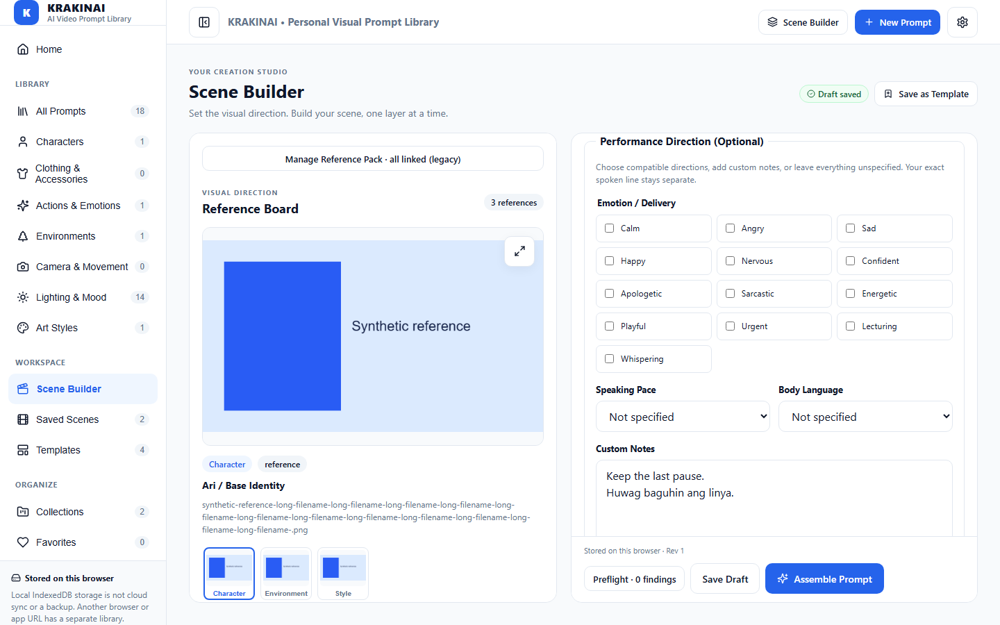 | 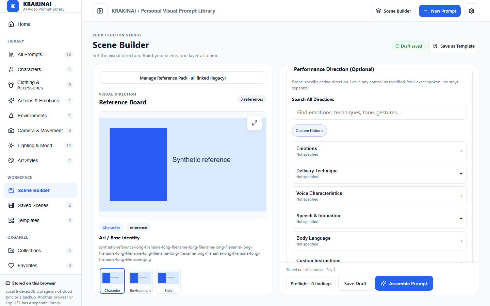 |

| Mixed emotions | Optional voice characteristics |
| --- | --- |
| 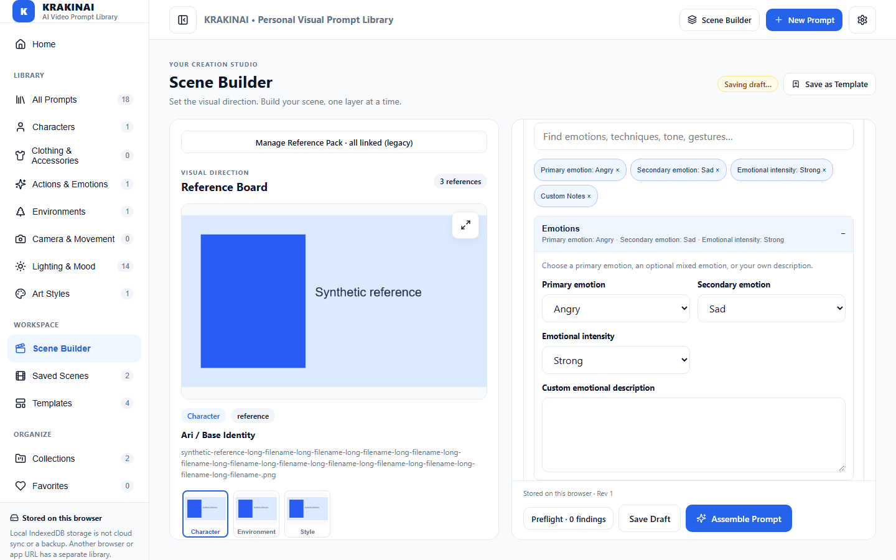 |  |

| Technique conflicts | Long Unicode effective preview |
| --- | --- |
| 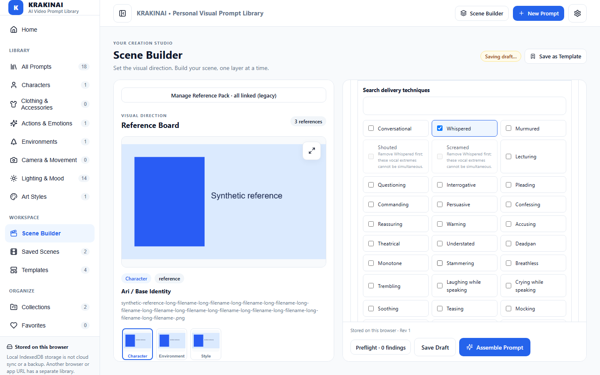 | 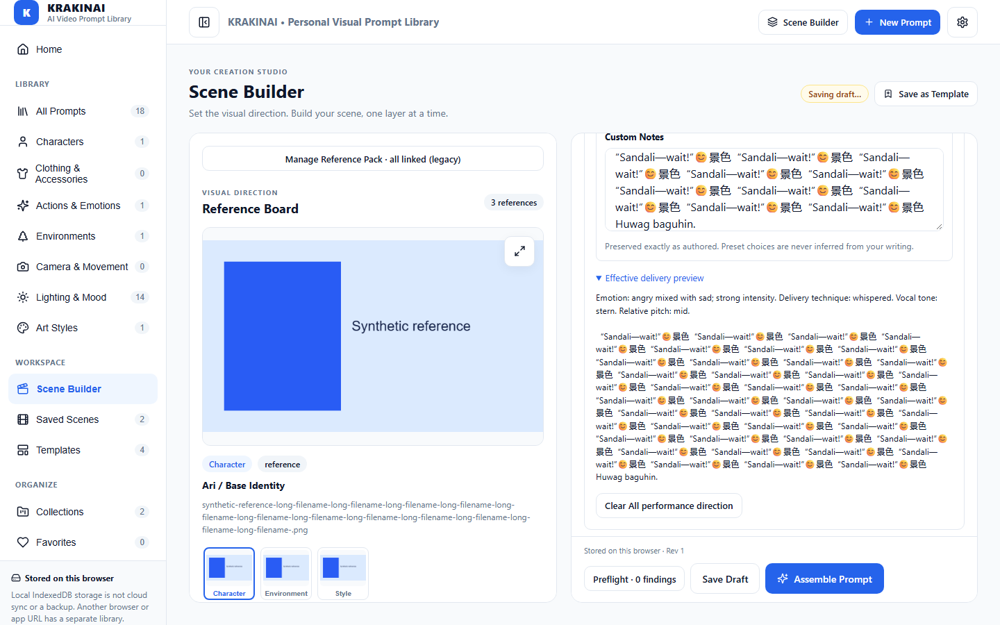 |

## 768px before and after

| Before | After |
| --- | --- |
| 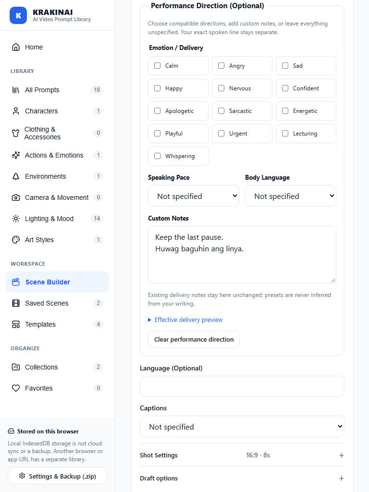 | 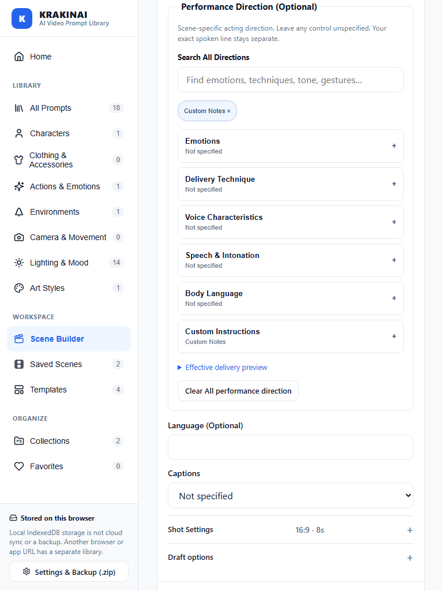 |

| Mixed emotions | Optional voice characteristics |
| --- | --- |
| 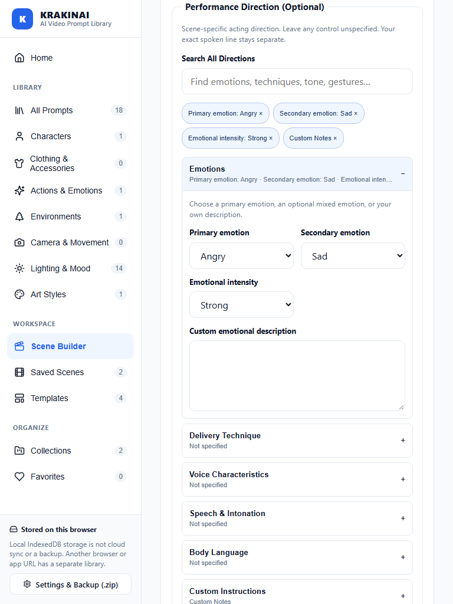 | 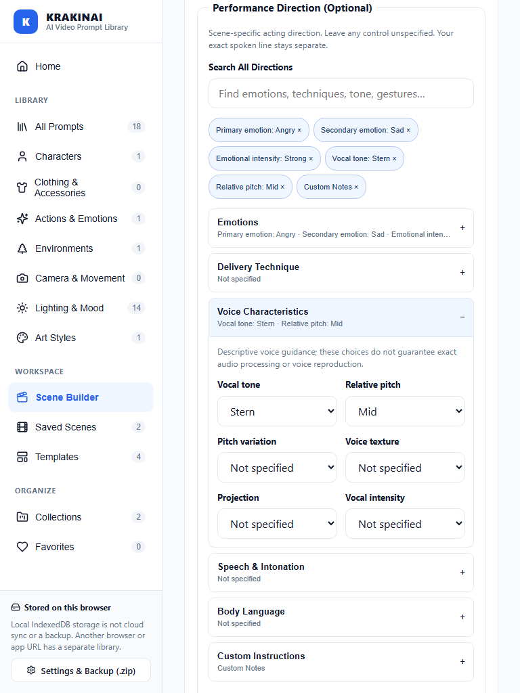 |

| Technique conflicts | Long Unicode effective preview |
| --- | --- |
| 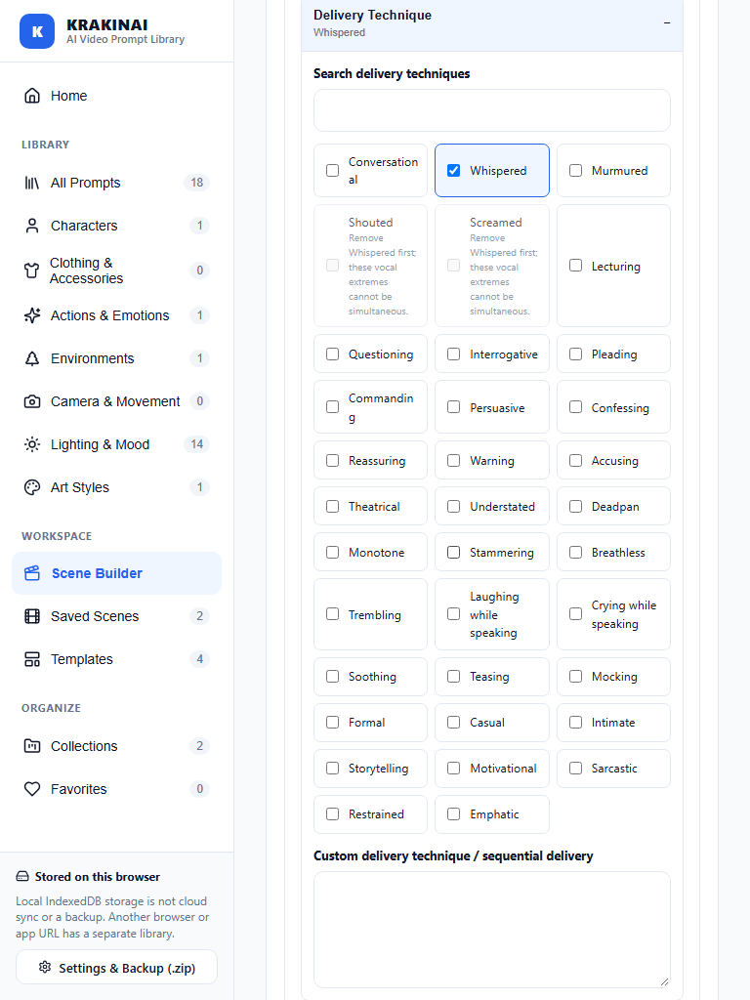 | 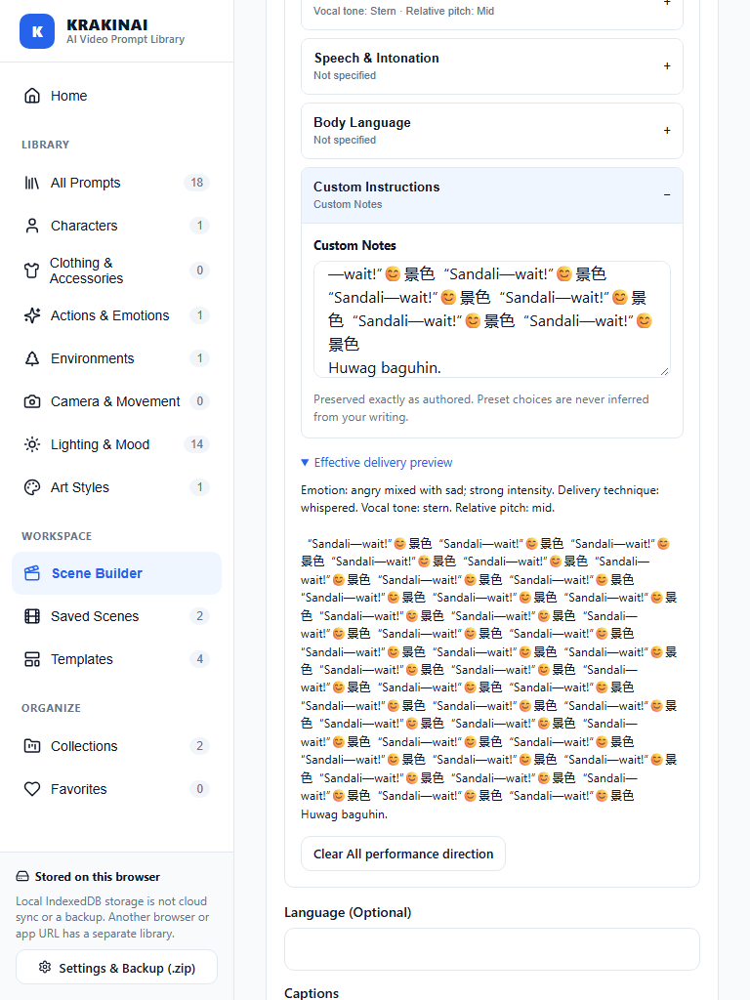 |

## 390px before and after

| Before | After |
| --- | --- |
| 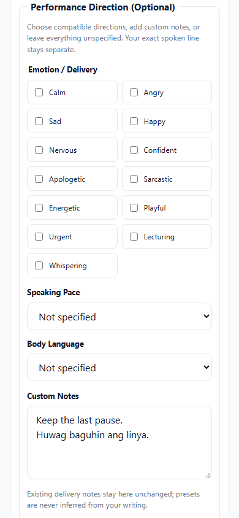 | 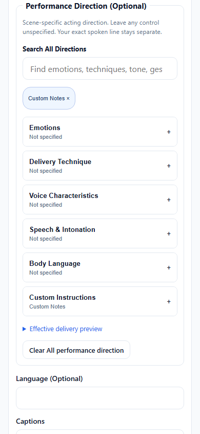 |

| Mixed emotions | Optional voice characteristics |
| --- | --- |
| 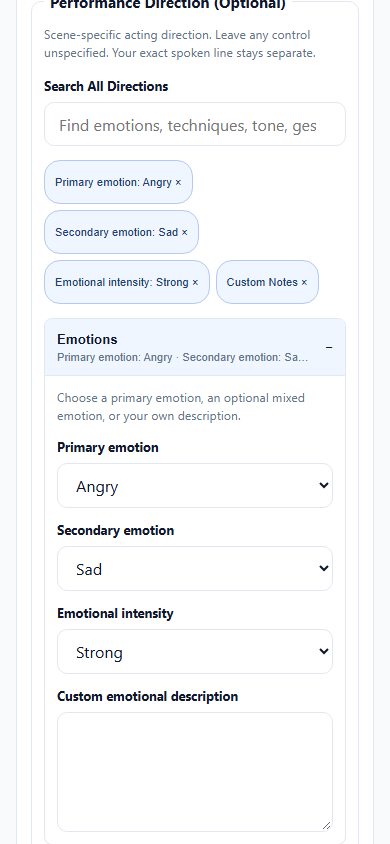 | 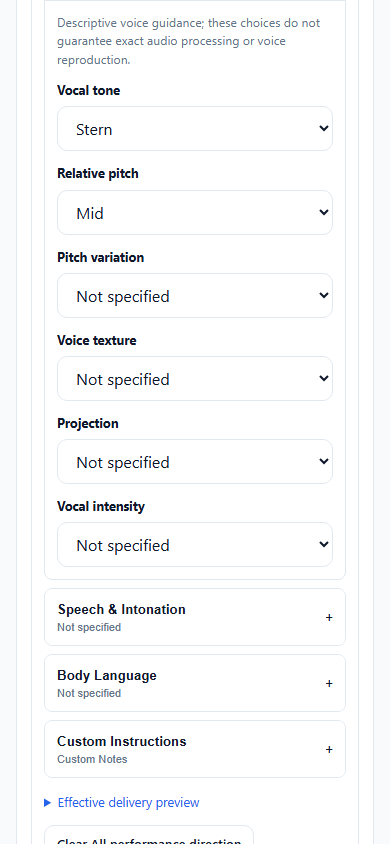 |

| Technique conflicts | Long Unicode effective preview |
| --- | --- |
| 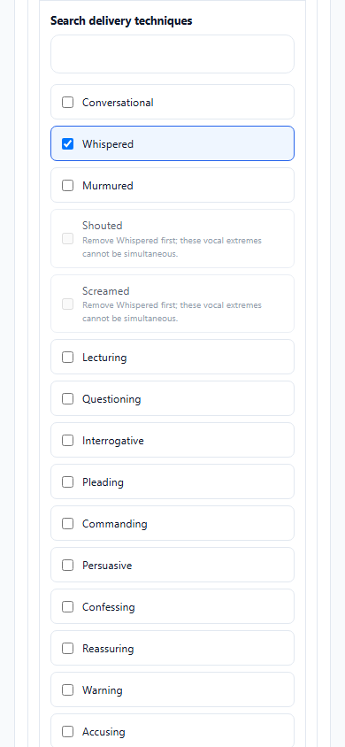 | 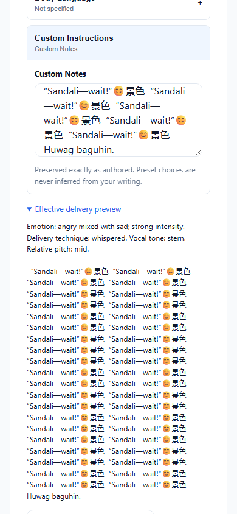 |

## Effective 200% reflow

720×450 CSS viewport emulates the layout space available in a 1440×900 window at 200% zoom. This is viewport emulation, not a browser chrome zoom action. The capture waits for the responsive sidebar transition to finish.

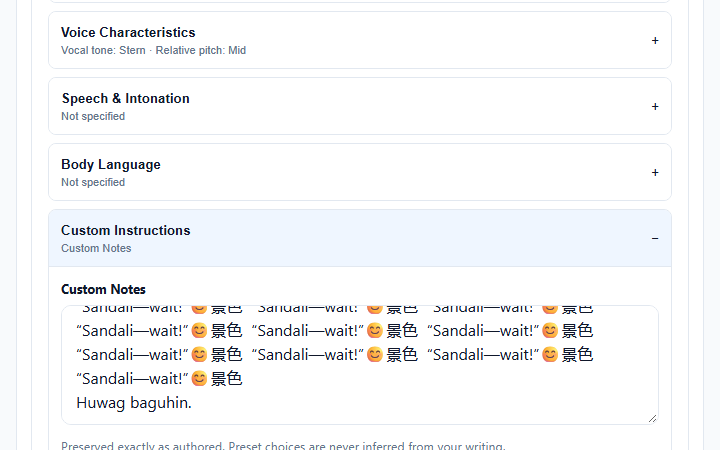
